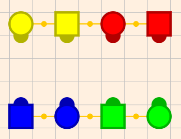
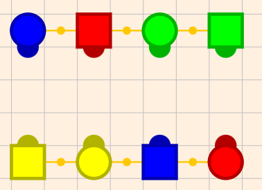

# When You Are Just Thinking About Calling

If you are just thinking about calling, you don’t need to pick up a microphone to discover SOME of what it is like to be a caller.   The basic idea is to watch CAREFULLY what is happening as someone else calls and notice some properties of the square.    Most dancers know the concept of the ‘mirror’ that states that you and the person who is the same gender in the opposite couple will always be ‘mirror images’ of each other in the square.   This is SUPER helpful for calling because the caller only has to remember HALF the square (since the other half will be determined by the mirror property).    But there are more properties of squares that are useful to calling that you can observe when you are dancing.  

## Even and Odd Stations

Most dancers have noticed that when the squares are in facing lines as normal couples, sometimes everyone is ‘coupled up’ and other times only one couple is together and the other couple is ‘swapped’ with their opposite.  

| Even Station (all coupled up) | Odd Station (2 coupled up) |
|:---:|:---:|
|  |  |

Squares where everyone is coupled up I will call **even station** and squares where  only one couple is together I will call **odd station**.   What is interesting is that 

1. These are the ONLY two possibilities (assuming the couples are normal and at least one of the couples is paired up, and you don’t care about order of couples).     
2. This concept of a **station** can be defined so you can determine what station a square is in from ANY formation (not just lines).    Thus it is something you can ‘track’ in real time as you dance no matter what formation the dancers are in.  
3. There are VERY FEW calls that will move back and forth between even and odd stations.   Thus it is easy to WATCH for when these transitions happen.  
4. The technique for resolving a square is quite different for even and odd stations.   Thus you can often easily ‘spot’ when the caller is trying to resolve the square, and you can make an accurate guess on what the next call will be.  

We will discuss the concept of **stations** in depth in the [joy of stations section](06-learning-to-resolve-a-square.md#the-joy-of-stations).     The point I want to make now is that there are interesting things you can do **as a dancer** that will increase your appreciation for square dance choreography, and this knowledge will be helpful if you ever decide to be a caller.   So if you just want to appreciate the hidden patterns of square dance choreography, feel free to skip to the [joy of stations section](06-learning-to-resolve-a-square.md#the-joy-of-stations) and watch for station changes as a dancer.   

## Memory practice (who’s your corner?)

There is no getting out of the fact that a caller has to remember AT LEAST three people to resolve a mixed up square.   This is a COUPLE, and the corner for that couple (typically it is the man’s corner, but it could just as easily be the lady’s corner).  This information, along with the even-odd station of the square will allow the caller to resolve ANY square.   Remembering the couple is often easy (you know particular people dance together, or a couple wears matching clothing), however remembering the corner is MUCH harder because it is arbitrary and likely changes every tip.  

You know remembering corners is HARD because even **experienced** callers make this mistake **routinely**.  The problem is that human memory is **DESIGNED TO FORGET THINGS** after about 10 seconds (most things are not worth remembering longer than that).  Only things that are **IMPORTANT** get remembered longer than that, and for your brain **only things that are RECALLED are considered IMPORTANT**.  Thus **to remember** something you have **to recall it** while you still can remember it.    If you REPEAT this, recalling the information again and again, and each time you recall it, you are likely to remember it longer.  Each time you recall, you can wait LONGER before you have to recall it again (in fact it works better that way).  

For example, imagine you are at a party and you are meeting new people.  If you want to remember the name of someone you just met, you should first NOTE the name when you first hear it (making it important).    It also is helpful to USE the recalled name and ASSOCIATE it with things you **already** know (e.g. recall other people with that name, or words that the name sounds like, or words that rhymes with it, ANY associations are helpful) Then after 5-10 seconds you should just bring to mind this person’s name (while you can still remember it).   Then 10-20 seconds later again recall this person’s name.    Do it again after 3 minutes, and again in 10 mins, and again an hour later.   If you do this you ARE likely to remember that person’s name.   

The important point is that **remembering is about DISCIPLINE.**   IF you are DISCIPLINED and RECALL a particular fact several times over the interval when you still remember it, then you WILL promote the memory into longer term storage and remember it longer, and if you do this enough and over large enough periods of time, you WILL remember that new fact forever.   

The big problem is that it is easy to ‘forget to recall’.   You get distracted and forget to RECALL the fact you just learned.   If you get distracted long enough, you will let the new piece of information slip out of your recall window.   This is definitely a problem but it is also solvable.   If the information is important enough, You COULD set an alarm on your phone so you will not ‘forget-to-recall.   If you go to the trouble of resetting the alarm each time you recall, then you are certain to force enough recalls to implant the memory.   Notice that ANYONE who is **sufficiently disciplined**, can remember a fact that is IMPORTANT enough to go to the effort of setting alarms on their phone.   

The good news is that in square dancing the problem is easier and we don’t need to go to the trouble of setting phone alarms.   First, you typically only have to remember one fact (your focus couple’s corner), AND you only have to remember it for a limited time (a full tip, which is less than 20 min).    Moreover, calls themselves (or full figures that bring the square home), act as TIMEKEEPERS.   This suggests the following procedure

1) Note the corner when you start the tip (recall several details about the person and the corner (e.g. color of clothes, hair color, or anything distinctive).    
2) After about 3 or 4 calls (&lt; 10 sec), FIND your couple and corner in the formation (thus forcing a RECALL)  
3) WHENEVER the square is about to be resolved, AGAIN NOTE your couple and corner.  (this probably happens every 30 seconds or so).  

IF you do this, you WILL remember your couple and corner.   Again it is about **DISCIPLINE**.     Also note that  you don’t need to be the caller to do this, **you can do this as a dancer**.  Simply note who your corner and partner are.   Then every several calls, look where you corner and your partner are (which force you to remember who that is).    It is OK (in fact better) if you think about other things between these recall attempts.    Once you reliably always check on your corner and partner  (and thus remember who they are)  you can make it a bit harder by noting where the corner’s partner is as well (thus remembering 3 three people (along with yourself).    You may think this is easy, but the trick is to do it RELIABLY.   Promise yourself that you will do this on every tip of a dance (just like the caller), and see if you can get 100% accuracy throughout the dance (this is what the caller has to do).   

Finally if you succeed in all of this, instead of using yourself as your focus person/couple (which is easier), try doing it where you remember your OPPOSITE couple and their corner.  This is harder, but more like what a caller has to do.   If you can do this you have mastered what is perhaps the hardest part of what a caller does when resolving a square (and all it took was getting into the HABIT of RECALLING a small fact (your corner) at intervals).
