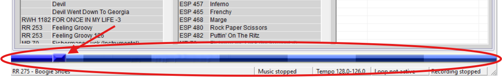

# Your First Singing Call

To help you out I would suggest the following song your first Singing call:

[Boogie Shoes](https://rhythmrecords.org/music/?1742_search_1=275&1742_orderby=relevance&1742_filtered=true) 

This song is one of the best to start with because

1. It is EASY TO SING.   You are talking to music, so even people who are not very musical can typically do this well (it is more about attitude than anything else).     
2. It is EASY for the dancers.   The music is slow enough that dancers can keep up easily, and the lyrics are sparse, so the calls are easy to find between the lyrics.    
3. The promenade part of each figure is EASY to find (it has backup vocals in it), which means if you mess up and need to ‘resync’ it is easy to find that spot.   
4. The middle break and closer sections are the same music as the figure sections.  Thus if you accidentally confused whether you are on a figure or on a break/closer, you can recover.    
5. It is a CLASSIC song that most callers will have, and dancers will be familiar with it.    
6. The cue sheet that comes with it is GOOD (so you can use it unmodified),   
7. It is cheap.   You can literally buy the song for $6, by following the link above.   This is about as cheap as they get.  

So if you have never called, just go to Rhythm records [Boogie Shoes](https://rhythmrecords.org/music/?1742_search_1=275&1742_orderby=relevance&1742_filtered=true) entry, play the ‘Vocal’ button that will play the song with Wade Driver singing, and sing along with him (On the web site it will only play ½ the song unless you buy the song, but you can get the idea).   The ‘Sheet’ button will give you the words (Note that the lyrics uses ‘**Turn thru**’, which has been taken off the mainstream list, you should say ‘**Turn your partner by the right**’ instead).  Memorize the words.   Do not rely on reading the lyrics during the performance\!   You want to perform the song WELL, and that means PRACTICE and by the time you have practiced the song enough you will have memorized it anyway. 

**TIP** :  Many people may be scared away from calling because they don’t think they sing well enough.   **Do not let fears about singing stop you**.   There are PLENTY of songs that are like Boogie Shoes that are ‘talking to music’.  If you can talk, you can ‘sing’ these songs.  Sure it would be better to sing well, but that happens through PRACTICE, and these ‘talking’ style songs will get you going.  If you don’t know which songs to start with you can look over my favorites on the [Singer](https://docs.google.com/spreadsheets/d/1gVKHymIl4wy7DxqTW0ZrK7qhrNoGjJMnaHkxOlATpME/edit#gid=360420083) page, to find some candidates.   ‘King of the road’, and ‘Witch Doctor’ are other songs that are more talking than singing.   Once you have a song title, you can go to the web sites in the [buying music section](08-callerbuddy-for-playing-music.md#buying-and-installing-new-music-into-callerbuddy) to actually purchase them.  

**TIP** :  There is a difference between **having learned something** well enough to do it, and learning it well enough so **you can’t fail to do it well**.    When you are performing you will be **NERVOUS** and **DISTRACTED** (squares will break, or something else happening on the floor will distract you).   Thus if you CAN do it wrong you WILL do it wrong.    You need to practice your song enough so that you will sing it properly even if your attention is somewhere else.   (I find singing in the shower works well.  After a week of that, I have learned the song well).   Practice, practice, practice, singing is fun, do it all the time\!

**TIP** :  When starting out, **it is better to learn one singing call REALLY WELL** than to know several singing calls imperfectly.    This is because at the start you are likely to only have ‘guest tips’ where you will only be asked to do one tip.   You want to make that ‘good first impression’ and you do that by having a ‘winning’ singing call.   Thus while I recommended [Boogie Shoes](https://rhythmrecords.org/music/?1742_search_1=275&1742_orderby=relevance&1742_filtered=true) it is MORE IMPORTANT that you **find a song that you really like** (and will happily sing day in and day out) and practice that song.   Practice it END TO END in the shower and any other place, and **use the same figure** (initially, later on you can expand).  This keeps it SIMPLE and as FOOLPROOF as possible.   Now you have the song you will sing when you need the performance to absolutely go well.   You are set for all your guest calling tips.    Later you can add to this (first by adding a few new singing calls, and later by adding multiple figures to each singing call).  

**TIP** : **Do not perform a new singing call until you have practiced it on at least 3-5 SEPARATE days PERFECTLY** and at least a day or two have passed since you have finished your 3rd perfect session.  The reason for this is that you need REPETITION and SLEEP BETWEEN REPETITIONS for your brain to really consolidate the memory in a way that is FOOLPROOF.   It is VERY TEMPTING to get a new song and want to perform it IMMEDIATELY.   This is a bad idea.   If you are a beginner it is a VERY BAD IDEA.   I have been burned by this more than once before I learned my lesson.    Learn from my mistakes.    Just perform a song you already know well, and perform the new song next time, after enough practice.  

**TIP** :  **Even if you make a HUGE MISTAKE during your singing call performance, it is better NOT to restart from the beginning.**  The reason is that dancers want to dance, and they WANT to see you succeed.   Dancers are USED to repairing squares (they have to do it because of dancer mistakes all the time), and thus repairing and continuing gets them dancing again FASTER and allows them to preserve the illusion that the dance did not go badly.    So if your singing call completely crashes do the following

1. Tell the dancers to get to a SQUARED SET (they do not need to go home, but the boys will tend to always go home, the girls may or may not (it does not matter)).  **The music is still going**.   
2. Your goal is to start them up again on the next figure, or middle break or closer.   Thus you have to wait for that point in the music.   This is where having a singing call with a solid ‘Refrain on the promenade’ helps.    You can have them simply wait, **but you can also ‘kill time’ by having them do the following**.   
    1. All 8 to the middle with a cowboy hell (kills a little time)  
    2. Circle left, you can wait up to 16 beats before you call ‘allemande left and promenade’.   A great time to stop the circle left is when the refrain starts.    
    3. Allemande left, turn partner by the right, Allemande left kills a bit more time.     
3. If your ‘killing time’ calls in step 2 goes long, **don’t sweat it\!**  Just do a circle-left, allemande-left, dosado, allemande-left, swing and promenade figure. This figure is very robust and magical because it can use more or less time based on when you stop the circle left.  Thus it tends to use up the right amount of time (all you need to do is do the allemande left at the correct time).    
4. If all else fails, just patter call your figure independently of the music and repeat as necessary.  The key is to simply give them something to do until the song ends.    
5. If you get home too early (e.g. you forgot a closer or one whole figure), Don’t sweat it, when they are  ‘home’ just have them bow to the partner and corner, and while they are doing that turn off the music.   
6. If the music runs out just get them home as quickly as you can without music and ask them to bow to their partner and corner and thank their square.  

    When the singing call breaks REALLY BADLY, your singing call becomes a patter call with swings.   Forget about singing lyrics.   If there are points where you are not calling and you know the words for the current point in the music go ahead and sing, but fade out whenever you need to call, and don’t worry about it.   The goal is to KEEP THEM DANCING.  

    In short, don’t stop a singing call, but salvage as much as you can by keeping them dancing during the music (A singing call is 3.5-4 minutes long).   They will have to repair their square at the end, but that is OK.   

**TIP:  Practice a broken singing call.**  Interestingly you can practice the recovery of a singing call.   Just start a singing call as normal and then at some ransom point force yourself to stop singing and think of something else for a few seconds.   Then try to repair using the strategies above (you can do this even with a ‘ghost’ square of no people except yourself)  You will find that the FIRST time you do this you will be REALLY BAD at it.   But after you do it 3 or 4 times, you actually get pretty good at it.   This will give you confidence in ‘real dances’ that you can recover from ‘anything’ and that is a very good feeling.  

**TIP:  Have ‘short’ figures memorized that you can use if dancers fall behind.**  It is pretty common, especially with older dancers and beginners that the dancers will not keep up with your singing call figure.    This messes up the singing call because the music expects you to start each figure at a particular point, and the dancers are late.    Thus you need a way of ‘catching up’.   Conveniently, the figure in Boogie Shoes can help you do this.   It consists of the following calls.

* Heads promenade ½  
* Heads Square through 4  
* Right and left thru  
* Pass thru  
* Trade By  
* Touch a quarter         ← You can drop these last two calls  
* Scoot Back 

Critically right before the ‘Touch a Quarter’ everyone is facing their corner so you can call ‘swing and promenade’ at that point, making the figure 8 beats shorter.   This allows you to catch up.  I call figures like this ‘expando’ figures because they can be shorter or longer as the need arises, and that is pretty helpful.    Thus if you are calling Boogie Shoes and you are ‘way behind’  you can drop the ‘Touch a Quarter, Scoot Back’ and catch up.   If that shaved off too much time, you can have the active couples ‘Come in to the middle and back’ before starting the figure to use up the extra time.   

Another point is that the structure of a singing call is 

1. Opener    
2. 2 Figures (each of these advance the girls one position)  
3. Middle Break   
4. 2 Figures (each of these advance the girls one position)  
5. Closer.    

Slow dancers will start to fall behind on the first figure.   But you can substitute a short figure on the NEXT figure to catch up (it is OK to miss the start of the second figure).  Your goal is to ‘catch the refrain’ when you are swinging and promenading on the second figure).   If you need **really** short figures I suggest

* Square thru 4  (you can swing and promenade)  
* If you need to kill a bit more time after the Square thru 4 call    
  * Swing Thru;  Boys Trade (you can swing and promenade)  
* If you need short, but not extremely short figure,  after the Square Thru 4 call  
  * Swing Thru, Boys Run; Ferris Wheel; Centers Pass Thru (you can swing and promenade)

Finally know that you can ALWAYS substitute the following sequence for ANY for the Opener, Middle Break, or Closer

* Circle Left  
* Allemande left  
* Turn your partner right (or Dosado)  
* Allemande left  
* Right and Left Grand  
* Swing and Promenade.  

Notice this is the Opener figure for [Boogie Shoes](https://rhythmrecords.org/music/?1742_search_1=275&1742_orderby=relevance&1742_filtered=true).    Thus you likely already know it.   It is also probably the single most common Opener-Break-Closer figure in square dance.   What is beautiful about this sequence is that YOU DO NOT NEED TO BE HOME TO START IT.   Thus if you are ‘behind’ you can simply use this sequence for the Middle-Break or Closer even though the dancers have not finished the promenade from the last figure.  

This figure is also ‘magical’ because it can use more or less time based on how long you wait on the Circle left (Normally you circle left  16 beats which gets you all the way around).  By simply calling the Allemande left sooner you can make the figure shorter and thus make up time.  

**TIP:  In Boogie Shoes Use a Circle Left Middle Break or Closer to catch up.** As written Boogie Shoes has either the girls or boys promenade at the break and in the closer.  If the square is ‘behind’ this is not a great figure to call.  So if you are behind at the middle break or closer, substitute a circle left figure and start it early before they get home.   This will catch you up.   You should practice this so that you can execute this ‘on the fly’ substitution with ease.  

**TIP:  If you want the most ROBUST singing call, use one that you have practiced with a ‘circle left’ middle break and closer.**    This will allow you to catch up quickly.   Grand Squares are  NOT as robust (although experienced dancers can catch up), so avoid them if you want your singing call to work even with novice dancers.  

**TIP:**  Use the **‘Tap Tempo’ app** and ensure your singing calls are **126 Beats Per Minute** (BPM).   The ‘Tap Tempo’ app is a FREE Phone app (both IPhone and Android) available in their app stores, that allows you to determine the tempo (BPM) of any music.  You do this by listening to the music and tapping a button on the beat of the music (it is surprisingly easy and accurate).    

Music players (like CallerBuddy or SqView) have the ability to adjust the tempo of the music so  you can always hit exactly 126 BPM.   Note that even 2 BPM faster feels FAST , and 2 BPM slower feels SLOW, so it is important to be accurate.   You may wish to slow the music down a bit (but no more than 2 BPM) for older dancers or beginners, but I don’t actually recommend that (just use shorter figures as mentioned above).  If you slow the music down you lose some of the ‘energy’ of the dance.  Using shorter figures does not have this problem.  

## A Database of figures to use for Singing Calls

As we will discuss later, ANY set of moves that bring you to ‘near’ (often facing) your corner in about 36-38 beats of music can be used as a singing call figure.   You will want to memorize a number of these. My favorites are in the spreadsheet [Square Dance Figures](https://docs.google.com/spreadsheets/d/1gVKHymIl4wy7DxqTW0ZrK7qhrNoGjJMnaHkxOlATpME/edit?usp=sharing).   Often as a beginning caller, you memorize only one figure that  you use 4 times and you never use another figure for that singing call.   It is GOOD to start this way, because it AVOIDs ERRORS (calling is just like singing a song, it is ALWAYS the same EVERY time).    However as you get better at calling you will want to use different figures.   This introduces the potential for mistake, and the way to MINIMIZE this is to PLAN which figures you will use and **WRITE THEM DOWN** and refer to your notes during the dance (this is called programming the dance).    I recommend using only 2 different figures for any particular singing call (not 4).   The reason is that figures feel very different to the dancers if they swap heads-sides roles, so you don’t need unique choreography for 4 figures.   Planning the 1 or 2 figures you will use in your singing calls has a a number of additional benefits

* You can ensure that during the patter you use the singing call sequence at least once.   That ensures that the dancers are ‘warmed up’ on the figure (really important for beginner dancers).   It also allows you to see if the figure is too hard for the current set of dancers and switch to an easier figure for the actual singing call if you decide the dancers need something easier.    
* You can ensure that you don’t overuse any single singing call figure (It is easy to ensure that you never  use it more than once that night, adding variety to your dance).  

**TIP: If you use 2 figures, A and B, use them either AABB or ABBA (NOT ABAB).**  As mentioned figures feel very different to dancers if you swap the head-sides roles in the figure.   However because the ladies are PROGRESSING after every figure, if you alternate the two figures (ABAB), then the ladies ONLY SEE one role of each figure twice.  This is not ideal.  If instead you start with the A figure twice and then the B figure twice (AABB) then EVERYONE will see each role of each figure exactly once.    While this works, dancers will notice that you are repeating a figure.   To avoid that, if you use figure A, then figure B twice and then go back to figure A (ABBA) then it is harder for dancers to see that you are repeating the figures but every dancer sees each roll on each figure exactly once (just like AABB).   I recommend always using the ABBA pattern for this reason.  

## More on the Structure of a Singing Call

As mentioned, a singing call consists of 7 parts.  

* Opener    
* 2 Figures   
* Middle Break   
* 2 Figures   
* Closer. 

Each of these sections (typically) is exactly 64 beats long.   If you set your tempo to 126 beats per minute as suggested. Then each section is .51 minutes or 30.5 seconds long.   Thus a singing call is 7 \*  30.5 = 3 minutes and 33.5 seconds long.    Typically songs have 5-10 seconds of lead in time, and a similar amount of time at the end of the song, so a typical singing call is close to 4 minutes long (some with long lead times are over 4 min).    Some singing calls might have a very short (e.g 4 beat) lead in for the Middle break or Closer figure ([Boogie Shoes](https://rhythmrecords.org/music/?1742_search_1=275&1742_orderby=relevance&1742_filtered=true) does this, check out the drum/horn pulsing right before the Middle break and Closer) .  You may not even notice these, but they are handy especially for grand square figures because they give dancers a few more beats to ‘catch up’ if they are behind.  

Because the 7 sections are ALL THE SAME SIZE it means that any figure for one section can be used in another.     This is actually true even for the opener, bridge, and closers.  This means if you make a mistake and accidentally miss one of the pieces (typically you forget if you are on the 3 or 4th ‘progression figures’, or less commonly you skip the middle break.   If that happens, just fill in the required piece that you forgot.  The order doesn't really matter as long as you do a ladies progression figure 4 times.  

It also means that if you sing the song with a grand square normally, but you are way behind, you can substitute the ‘magic’ circle left figure instead to catch up.   I have done this many times when working with beginners.  

Whether the heads or the sides start a figure never matters.   It is traditional to call the first two figures with heads starting, and the last two figures with sides starting, but you don’t have to do that.   Indeed when I call the same figure 4 times in a singing call, I tend to call Heads-Sides-Sides-Heads, because it ‘feels’ like there is less repetition.    The main point, however, is that if you accidentally called sides when you wanted to call heads, just go with it.  In general, correcting yourself never turns out well (It just breaks the floor), so just try to make the best of things given what you told the dancers.   In the case of saying heads when you meant sides, there is nothing to fix.   

Note that the CallerBuddy or SqView song playing tools also help you with the 7 parts of the singing call.   Notice at the bottom there is a ‘bar’ that is divided into 7 sections (one for each part).  This bar has a slider (see arrow below) that tells you where you are in those seven parts.

This is really handy near the end if you can’t remember if you should be doing the last figure or the closer.   A quick glance tells you where you are.

Note that CallerBuddy or SqView are NOT doing anything sophisticated to divide the song up into 7 parts.  It simply takes the total time of the song and divides it into 7 equal parts.  This means that it is not accounting for the lead in and trail out parts, and thus these sections will be a ‘bit off’, but this bar IS useful for just knowing (roughly) what section you are currently in.  

## Singing call Structure WITHIN a figure

As mentioned, each of the 7 parts of a singing call have 64 beats of music.   These 64 beats very naturally break up into 8, 8-beat parts.   If you look at song sheets, you will typically find that all the figures have 8 lines (this is true for [Boogie Shoes](https://rhythmrecords.org/music/?1742_search_1=275&1742_orderby=relevance&1742_filtered=true)).  Each line is 8 beats.   Notice that the last two lines are always some chorus, and take 16 beats  which is used for the promenade (it takes 16 beats to go around the square).   Before the chorus is a swing that takes 8 beats.    That leaves 64-16-8 = 40 beats of music for the rest of the figures.   Thus IN THEORY you have 40 beats of music for choreography that gets you to your corner so you can swing and promenade.      In practice, 40 beats of choreography is an upper bound that you use for very energetic dancers who want to move.    It may feel exhausting to many people.   36-38 seems to be the ‘sweet spot’ for good, competent dancers.   Beginners are slower and usually only handle 32-34 beats of choreography or they will fall behind.

Note that actual song lyrics  tend to be in 16 beat ‘sentences’.   This is why the chorus during the promenade is 16 beats.    This is why you tend to circle left for 16 beats, because it allows you to sing one full 16 beat ‘sentence’ of the lyrics.    Thus you have 2 ½ of these ‘sentences’ (40 beats) in your choreography before you tell them to swing and promenade.   Typically you can ‘feel’ these 16 beat transitions, and they can help you keep your choreography on track.  

## Filler Words are your Friend

You will note that in the figure for Boogie Shoes, there are filler words like ‘go all the way and do a right and left thru’.  Those words are important, because beginner callers often do NOT LET THE DANCERS HAVE TIME TO DO THE CALL.    A square thru 4 takes 10 beats, which is a lot longer than it takes to say it.   This leads to the following tip

**TIP:**  When you are first practicing a new figure with a singing call, DANCE it yourself (with ghosts) as you sing it.   That will  FORCE you to put appropriate pauses between the commands.   Ideally you come up with ‘filler words’ to fill the silence because that ensures that you KEEP those pauses (just having a pause is fine, but it is easy to forget how long the pause should be, filler words force you to remember the correct space between commands).  

**TIP:**  When coming up with filler words, **make sure commands are early enough**.   Chain down the line takes a lot of time so some filler words are in order, but if you call ‘and then do a chain down the line’ notice that the command is LATE which is a BIG PROBLEM.  The COMMAND needs to come early, so filler words need to come LATE, thus ‘chain down the line, turn the girl and don’t be late’ is a better set of filler words.  

**TIP:**  **MODIFY the song sheet in your Music Player**.   If you use CallerBuddy or SqView to play your music and bring up your lyrics (more on that later), you will want to MODIFY the lyrics to use your preferred figure and your filler words.   SOMETIMES the lyrics that come with the song are fine, but more often than not they need to be modified.   DO THIS MODIFICATION.   You will forget all the subtle changes you made a couple months ago if you don’t write the changes down, and you really do want as much help from the lyrics as possible.
