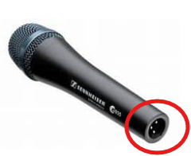
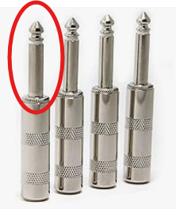
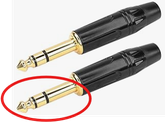

# Equipment and Software You will Need

Once I was part of a large group of square dancers that was visiting a tourist site, but there were not enough buses to take us home.   Thus some of us had to wait a significant time (over an hour) for another bus.    There were callers in our group and enough room to dance, so they put on an impromptu square dance singing a cappella.   It was very cool, but in real life you need some equipment.   This includes

1. A microphone and cord  
2. Something to play the music (usually a computer, but some people use a phone)  
3. A mixer / amplifier that combines the mic and music and amplifies it  
4. Speakers to turn it into sound.  

Sometimes the hall where you square dance provides the mixer, amplifier and speakers, so all you need is a microphone, its cord, your computer, and probably another small cord that connects the computer to the ‘house’ mixer.   This is the typical situation at square dance festivals.   Thus at a minimum you need

1. A microphone, and cord  
2. A computer/phone and software to play music  
3. A short cord that connects your computer to the mixer.  

It turns out that the square dance community and sound professionals BOTH have standards for these cords but they are DIFFERENT STANDARDS and that can cause some grief.   Let’s talk about those details.  

## Buying a Microphone

You might get lots of conflicting advice about microphones.   The price for microphones also varies WIDELY.  You can buy a $10 microphone or a $200 one.    You can buy them on Amazon, or at any good musicians store (e.g. [Guitar Center](http://www.guitarcenter.com) or the like).    I don’t have strong feelings on the matter but I will say

1. The standard for GOOD microphones is an XLR connector.   It is good to adopt this standard.  It has existed for many decades and there is no reason for it to change.    
2. It is GOOD not to buy the very cheapest of anything when you are concerned about quality.   It is often not clear why you should buy really expensive stuff, but if you buy the very lowest end stuff, it is very likely to disappoint you in ways you will only find out after the purchase.    
3. It is OK to buy lower end things first, then upgrade if/when you feel the need.  This gives you time to understand what  you value and make a WELL INFORMED choice later (when it is clear you will value the new version you will buy).   If on the other hand you don’t end up calling a lot, buying the lower end saves you money.  99% of calling is about YOU not your mic.    

So my advice on microphones is that you buy an inexpensive, but not rock bottom XLR microphone.  This is enough for the start of your calling career, and if you continue, you can upgrade if you wish.     

## Common problems with Microphone Cables

Professional Microphones typically have a three-prong connector called an XLR Connector.    

Microphones need THREE prongs rather than TWO because they are what we call ‘balanced’ sources.   It turns out that you can SUPPRESS noise by splitting your signal into two equal and opposite pieces with a common midpoint typically called ground or neutral.  External noise typically gets induced on BOTH pieces but since signal is the DIFFERENCE between the two pieces the noise (which is the same in both lines) cancels out.   You don’t need to understand that, but the point is that three wires is better than two when the signals are SMALL (like they are for a microphone).  

Unfortunately, square dancing started long ago before balanced microphones were the standard.    The square dance community standardized on Hilton equipment, and it used an UNBALANCED (2 wire or prong) ¼” connector.   

Notice that this connector only has two contacts (the TIP (the part above the white insulator), and the SLEEVE (the shaft below the white insulator)). This is the standard for most square-dance only equipment.   

Now when you buy a ‘normal’  cable that will take an XLR connector on one side (for the mic) and a ¼” audio cable on the other end (for your mixer/amplifier) it will have THREE wires and its connector will look like this

Notice there are TWO insulating bands (this time black), and thus THREE prongs (just like XLR), so the tip and the ring are the signals, and the rest of the shaft (the sleeve) is the neutral or ground.   

Unfortunately if you plug such a cable (which is providing a BALANCED signal) into Hilton equipment (which is expecting an UNBALANCED signal) bad things happen including

* You get very poor signal (you have to turn the amplifier way up to hear anything)  
* You get lots of noise (lots of crackling, hum or other noise).  

The reason is that when you plug your balanced (3 pin) jack into the unbalanced (2 pin) amplifier one of the pins is ‘floating’, not connected to anything (which is where the noise gets in).   Often this is blamed on a ‘bad’ cable.   There really is nothing wrong with the cable (it is doing what it was designed to do) it is just the WRONG CABLE.

What you need is a cable that converts from a BALANCED XLR connector to an UNBALANCED ¼” audio cable. This is actually pretty easy to do, you just connect one half of the signal to neutral (that is, you short the middle ring to the sleeve (or short XLR pins 1 and 3)).  If you are handy with a soldering iron you can do this yourself.  You can also buy cables that have this already done.  Here is one on Amazon, but I am sure you can find them in many places.  

[XLR to UNBALANCED ¼ Audio Cable](https://www.amazon.com/TISINO-Cable-Quarter-Unbalanced-Interconnect/dp/B083R4JBGP/ref=sr_1_4?crid=IPJSSSDBE12M&dib=eyJ2IjoiMSJ9.a-jj2GOMdIJJYGb_5-1wWVVaRPr8kb1GOs7Zsz6Nzxz70EZerQmCGtdDm_HflIrODCcu66pPWUY_nbHeucUoEKITKzxG4gVuTGMcFnKTAeX_3CegNO_CEtdEmG2Zx-HnisEQAWzgBpZYgWc_yGlmtdVnBvNdvGSufChk_uWpqXBOK017to_6rRNuTPnG-OYSg03LcH_pAc90vsNhOSpncxRiRiIkc-UDU2CyMXwZ4_q8sgbHEqyfQkx4Lh5r_gMoA5HusdFJehwJbXD2HvQIsHiwVLLPeumkf2cMhGQKBC8.iW9q2Psokkh6c9bXJQ3GNt2O2MzaLlmr5n4kR7SG9ns&dib_tag=se&keywords=balanced%2BXLR%2Bto%2Bunbalanced%2B1%2F4%2Baudio%2Bcable&qid=1714835696&sprefix=balanced%2Bxlr%2Bto%2Bunbalanced%2B1%2F4%2Baudio%2Bcable%2Caps%2C205&sr=8-4&th=1) 

The main point is that **if you are having trouble getting your mic to work with Hilton equipment**. It is VERY LIKELY it is because you are using a BALANCED cable to connect them.    If your ¼ plug has three sections (and you did not modify it), it is likely a BALANCED cable and it is the source of your problem.  

Note that the cable that converts to UNBALANCED will work in more modern audio equipment (e.g. pretty much any mixer you will buy). HOWEVER you have sacrificed ½ your signal (because a converter cable simply shorts out half the signal), and it also sacrifices any noise canceling (the whole point of having a balanced system).   Thus if you routinely  work on BOTH Hilton (unbalanced) equipment as well as modern (balanced) equipment, it would not be a bad idea to have TWO cables (one converts and the other does not, properly labeled) so you can be optimal for both.  

## Connecting Your Computer/Phone to the Mixer/Amplifier

Thankfully the other cable  you need is much less problematic than microphone cable.   The reason is that the signals from the computer are MUCH larger than what a microphone produces so noise is not an issue, so the standard is UNBALANCED for everyone.   The size jack is 3.5mm (slightly larger than ⅛”) and is standard.   Most cables are STEREO (they have three conductors and their plugs have two insulating bands).   We really don’t need the STEREO feature (all square dance music has identical left and right channels).  But stereo is the standard, and it does not hurt, so everything is fine.   You probably want a 3-4 ft cable length (any more and the cable tangles).  

Note that some phones and some computers no longer have a 3.5mm audio output (they assume that you will use Bluetooth to connect audio devices).    The good news is that for very little money (e.g. $10) you can buy a USB to 3.5mm audio converter (it looks like a short cable)  that you can plug into your computer or your phone.    Note that more modern devices will use a version of USB called USB-C, which distinguishes it from the older (larger) USB-A (or just USB) connector.   Be sure you get the right one for your device (nowadays, most computers have BOTH USB-A and USB-C).  

## Getting a Mixer/Amplifier/Speakers

So far you have invested in a Microphone, cable, and audio cable to connect your computer or phone  to OTHER PEOPLE’s amplifiers/speakers.    However you are likely at some point to want to call a dance somewhere that does not have audio equipment on site.   For that you need your own Mixer/Amplifier/Speakers.

Now old-school calling equipment (Hilton) was VERY expensive in its day (at least hundreds of dollars).   You can now often find used equipment that is a fraction of the price but STILL EXPENSIVE by modern standards.   Basically Hilton equipment has not changed in decades, but electronics has, and it has gotten a lot cheaper.   

I happened to luck out and be GIVEN old equipment, which is what I use, but it is STILL HEAVY (lots of particle board in that stuff).    I have seen numerous callers invest in a mixer and powered speakers (sometimes wired, sometimes wireless), which is certainly an option.   But I am a bit thrifty (cheapskate) and I would like to discuss the merits of buying a **Portable PA Speaker**.   
Here is one on Amazon for $60 

[Portable PA Speaker](https://www.amazon.com/Portable-Bluetooth-Speaker-System-Rechargeable/dp/B08BTYTX1M/ref=sr_1_23?crid=1QMEU5114MKBK&dib=eyJ2IjoiMSJ9.xXZuQbTIz8Q5mfWsJlkKJJ3riu25r1ktSuvhCQAFewN6c61Jyic1-vOFvEDU-uUxS3aU1ZypM6eJ6fVLXo-fafKiKko6GgjHWQ-QIW3SrMywiCin77S2vNmGDdvhF7Fl_t1AFjqzu2Z_ENZr3r90Nv7E6XeGOR7OPY2DP6WbXjEmPP9IQ-KIJA5Ao6CMkxatju9DZEXLSoyqfMTD9txrbj00RxW80ZlosAN-H34K8wjrBmlF1J0jYz4bNSAFHI0DGnO8QL4PwUbnqO5lmBpXiWaXsqBkuaD7M7f4861ukG4.U0byMe4-G4SNs9yMeSwa6tHd_vERTx-xF2gRU0OYzEI&dib_tag=se&keywords=portable+PA+speaker&qid=1714838604&sprefix=portable+pa+speaker%2Caps%2C206&sr=8-23)

PA stands for Public Address, and these systems are basically designed to be used outside (thus powered by built-in rechargeable batteries), to combine a microphone and music (exactly what is needed) all in one easy to carry package (and for $60).    

Because the price is so low, even if you decide later that you want better equipment, in the time you used it you very likely got the $60 of value out of the purchase.   I also think there are plenty of times where convenience is more important than audio fidelity, so you are likely to use it on occasion even if you end up investing in better equipment.
