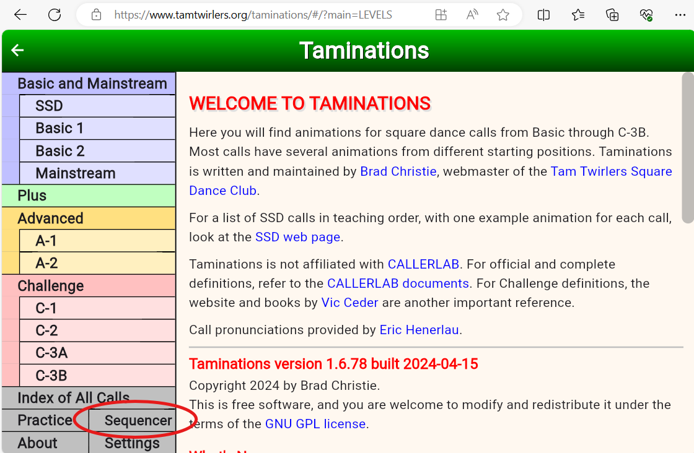
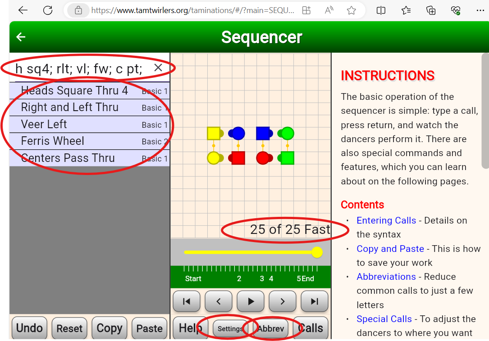
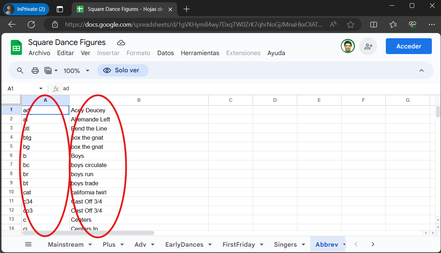
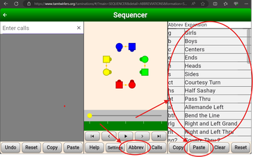
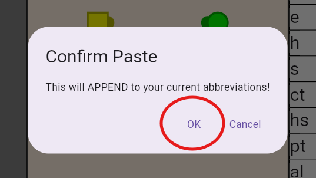
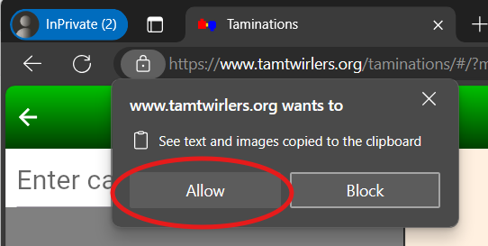
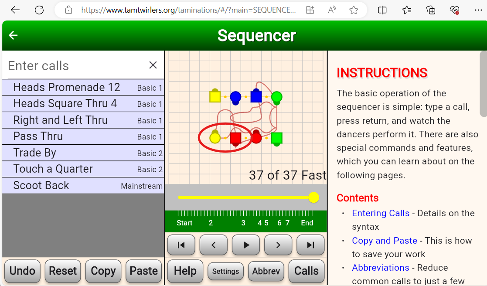
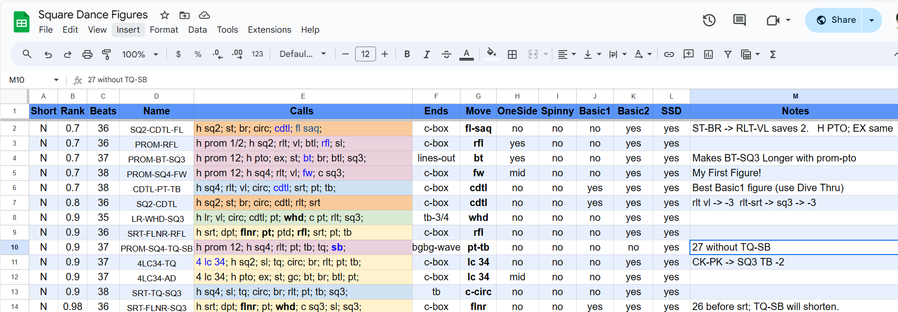

# The Taminations Sequencer Is INDISPENSABLE

You may already know about the FREE [Taminations web site](https://www.tamtwirlers.org/taminations/#/?main=LEVELS) as a reference guide of square dance calls.  There is also a Phone FREE version of this for both Android  and iPhone in their respective app stores (search for Taminations).    What you may not know about, is that Taminations has a tool called the [sequencer](https://www.tamtwirlers.org/taminations/#/?main=SEQUENCER&formation=Squared+Set&helplink=info/sequencer), that lets you visualize choreography.    Old school callers use 8 small items typically called ‘checkers’ or ‘dolls’ that represent each of the 8 dancers which they would move around manually to simulate choreography.    However that technique was always very slow for me (since you have to move all the pieces) and ERROR prone (you can easily not perform the move correctly with your checkers, or lose track of where you are in the sequence you are designing).    I LOVE Taminations as an alternative.  

To get to the Taminations web site, go to the site 

[www\.tamtwirlers.org/taminations](http://www.tamtwirlers.org/taminations)

Note that if you just search for ‘taminations’ you will get links to the APP (which you will want to use on your phone, but do NOT need to use on your PC).  You will also get web sites associated with the tamtwirlers square dance club (who developed the software), which is also not what you want (but it will have a link to the website you want).    When you find the correct link you will see a display like the one below

For our purposes the interesting part is the sequencer and you can get to it by clicking the button labeled ‘Sequencer’ in the lower left region of the window (circled in the image above).  

When you enter the sequencer, you get a display that looks something like this:  

Notice it has a data entry box in the upper left corner, in which I have already typed the abbreviations for 5 calls separated by semicolons ’;’.   Hopefully these abbreviations are intuitive, but even if they are not, when I hit the &lt;enter\> key the sequencer processed these abbreviations and has the full name one per line in the area below the input box.  To the right are figures of the 8 dancers (reds are the number 1 couple, and yellows are the corner couple (number 4 couple)).    Notice that everyone is facing their corner, so you could call ‘allemande left’ at this point (or use it in a singing call and swing and promenade at this point).  

The sequencer keeps track of how many beats the move takes and gives you a tally (in this case this sequence is 25 beats long),   Below the animation of the figures are controls that let you ‘run through’ the sequence.   The sequencer animates every movement so you get to see the ‘flow’.  You can also click on any particular dancer and it will show you the path that dancer took (to see if the choreography is too ‘spinny’ or only involves ½ the square).   Good choreography has figure 8s in the path that dancers take because the left and right rotations cancel out dizziness.   We also like it when dancers use both sides of the square (otherwise you are interacting with just 4 people instead of the full 8).   

**TIP:**  **Increase Dancer Speed in the Sequencer**.   The default speed for the dancer animations is too slow.   You can fix this by clicking the ‘settings’ button and then selecting the ‘Fast’ ‘Dancer Speed’ button.   While you are in the settings, I like to turn on the ‘Grid’ feature (just draws a grid on the dance floor), but that is definitely optional.   These settings will be remembered from session to session. 

## Adding more Abbreviations to the Sequencer

The sequencer is great, but you REALLY want every call that you use in the sequencer to have an abbreviation.   By default the sequencer only has about 40 abbreviations, and VERY COMMON calls like ‘star thru’ do not have abbreviations.   You will want to fix this.   This brings us to my [Square Dance Figures](https://docs.google.com/spreadsheets/d/1gVKHymIl4wy7DxqTW0ZrK7qhrNoGjJMnaHkxOlATpME/edit?usp=sharing) spreadsheet.   This is a spreadsheet that shows useful singing call figures for various levels of square dancing (Mainstream, Plus, Advanced) as well as other useful information, each on its own ‘tab’ (see the bottom of the display to see the tabs).   One of these tabs is the ‘Abbrev’ tab that has a list of square dance call abbreviations.    The following link  
[Abbrev Page of Square Dance Figures](https://docs.google.com/spreadsheets/d/1gVKHymIl4wy7DxqTW0ZrK7qhrNoGjJMnaHkxOlATpME/edit#gid=1976395250)

Will take you directly to this tab.   It should look like the display below.

To load these abbreviations into the Sequencer, first select EVERYTHING in the ‘Abbrev’ tab of the spreadsheet by typing Ctrl-A (which selects everything on the page) followed by Ctrl-C (which copies it to the clipboard).   (On an android phone, tap on any cell and it will surround the cell with a blue selection box. Then tap the upper left grey box (it is in the same row as the column headings).  This selects all the cells.   Press AND HOLD on any of the cells and it will bring up a menu.   Select the ‘copy’ entry).  

Now open the [sequencer](https://www.tamtwirlers.org/taminations/#/?main=SEQUENCER&formation=Squared+Set&helplink=info/sequencer) and click the ‘Abbrev’ button at the bottom of the display.  This will cause the right pane to be populated to the CURRENT set of abbreviations.   The right pane also has 4 buttons at the bottom, one of which is ‘Paste’

Click the ‘Paste’ button.  It will issue TWO confirmation dialogs,  Click OK to the first dialog   
And ‘Allow’ for the second (which the web browser forces on you).  

 

If you are successful you will see many abbreviations in the right pane. (you will have to scroll to see them),  Note that you can click  the ‘Expansion’ column heading  at the top to sort the list by the full name of the call, which will make it easier to find an abbreviation in the future.  

At this point you have set up Taminations enough to be useful.   When you look at figures in the [Square Dance Figures](https://docs.google.com/spreadsheets/d/1gVKHymIl4wy7DxqTW0ZrK7qhrNoGjJMnaHkxOlATpME/edit?usp=sharing) spreadsheet you can cut the text from the sequence and paste it into taminations, to ‘run’ it.  

## What is the Sequencer Good for?

The main thing that the Taminations [sequencer](https://www.tamtwirlers.org/taminations/#/?main=SEQUENCER&formation=Squared+Set&helplink=info/sequencer) is good for is to allow you to ‘practice’ calling without needing 8 people to form a square.    In particular it helps you memorize singing call sequences.   For example the singing call sequence used in Boogie Shoes is in [Square Dance Figures](https://docs.google.com/spreadsheets/d/1gVKHymIl4wy7DxqTW0ZrK7qhrNoGjJMnaHkxOlATpME/edit?usp=sharing) spreadsheet with the name **PROM-SQ4-TQ-SB** and has the sequence 

**h prom 12; h sq4; rlt; pt; tb; tq; sb;**  

Which hopefully you can read (see image of Taminations below if you can’t guess it).   From here on I will be writing sequences of calls using these abbreviations.    The nice thing about doing this is that you can cut and paste this sequence into the  [sequencer](https://www.tamtwirlers.org/taminations/#/?main=SEQUENCER&formation=Squared+Set&helplink=info/sequencer) to make sure it is ‘correct’ (a legal set of calls), and determine how many beats of music it needs.    This sequence needs 37 beats, which is in the sweet spot of 36-38 beats for a singing call.   If you cut and paste this sequence into taminations and hit &lt;Enter\>, it will run the sequence and leave you with the following display

Notice that the \#1 boy (red) is in a wave next to his corner, the \#4 girl (yellow).  Every other person is also next to their corner (you can see this because if you IGNORE the facing directions the figures resemble a squared set  (reds on bottom, greens to their right, then blues and finally yellows). This means you can call ‘swing and promenade’ legally.    In the example above I have turned on trace tracking for the \#1 (red) man by clicking on him in the figure.  Notice that the head man roams all around the square.  This is a sign of good choreography.   If you click on any of the side people you will see that they do not move around much at all.  This is why it is fine to use only two distinct figures in a singing call.  As you can see the experience of the sides is very different than that of the heads, and it is more ‘fair’ if you let everyone get to have both experiences.   As mentioned because the ladies are progressing on each figure, to be fair to them an ABBA sequencing of figures is best.  

While this figure works well for singing calls, it would be BAD to call ‘allemande left’ at the end of this figure because although everyone is close to their corner, they have RIGHT hands with each other, and if you call allemande left you force them to switch hands in an awkward way.   Thus if you want to ‘practice’ this figure during the patter (a very good idea), you will need a way of getting to a formation where you can do an allemande left.    This is what the **‘Ends’** column in the [Square Dance Figures](https://docs.google.com/spreadsheets/d/1gVKHymIl4wy7DxqTW0ZrK7qhrNoGjJMnaHkxOlATpME/edit?usp=sharing) spreadsheet is for.    It tells you the formation in which the figure ends.   ‘**c-box’** is one of the more common ones, which stands for ‘corner box’.   This is the formation after you have done a square thru 4 (everyone is facing their corner).   Another common one is **‘lines-out’** which are lines facing out and everyone is next to their corner.  You can do an allemande-left from there.  However our ‘Boogie Shoes’ figure ends in **‘gbgb-wave’** which stands for girl-boy-girl-boy waves (right handed is assumed).  This distinguishes it from ‘**bggb-wave’** which is what you get when you step to a wave from normal couples.   In neither of these waves is it a good idea to immediately call an allemande left.  You need a sequence to ‘fix’ things.   There are many of them, but here are two of the simplest.

* For gbgb-wave \-   **br; sq3;**   (boys run; square through 3\)  
* For bggb-wave \- **st; br; fw; c pt;**  (swing thru; boys run; ferris wheel; centers pass thru)

So in your patter, when you are doing a ‘trial run’ of your singing call figure, if the figure ends in waves, you know what to append during the patter so that you can call allemande left.   For boogie shoes I would call

**h prom 12; h sq4; rlt; pt; tb; tq; sb; br; sq3; al;**

## Memorizing singing call figures

You will want to memorize a bunch of singing call figures.   You will use them in singing calls, but you will also use them in PATTER.  You do this because it is GOOD to ‘dry run’ the figures you will use during the singing call, but ALSO because you have to REMEMBER who your focus couple is and who their CORNER is.   As mentioned previously you do this by NOTING it at the start, and then FORCING yourself to FIND these people every 3-5 calls.  (basically twice during a singing call figure).   Because you have MEMORIZED the singing call figure, and have used it ENOUGH MANY TIMES that it is HARD for you to mess it up, the fact that you are concentrating on finding corners and partners will not cause you to mess up the sequence.   If you keep reminding yourself who your focus people are over two or three singing call figures, you will have MEMORIZED the partner-corner people enough so that you can mess  the square up, and be reasonably certain you can resolve it.  

Singing call figures also often masquerade as what is called a ZERO (a sequence that returns people to where they start).   Because many singing calls START with a SQUARE THRU 4 (or an equivalent (we will talk about this more later), and END in a c-box (which is where a SQUARE THRU 4 ends), the part between the SQ4 (or equivalent) and the end is a ZERO.  Thus you now have a set of useful ZEROs that you can use to make longer sequences (by just stringing them together).  

Note that these singing call sequences are BETTER than things you come up with on the fly because

* They have been pre-vetted to have good properties like using both sides of the square, using appropriate hand alternation, and general flow.     
* Callers tend to use similar singing call figures, which means the dancers have been exposed to these sequences, which means that they will be MORE successful (they have some muscle memory for it).    More experienced dancers who are craving choreographic ‘surprises’ might be disappointed, but BEGINNERS will LOVE you for it.   This just means you need to know your audience and choose an appropriate mix, but some fraction of your patter should always include these good, ‘tried and true’ sequences.  
* It is VERY easy when ‘just calling’ to fall into a ‘rut’ where you tend to avoid some calls and use some calls too frequently or rely on just a few ‘cliche’ sequences.   By having a good number (ultimately dozens) of figures that are KNOWN to have some ‘interesting’ calls in them, you avoid falling into this rut.  

In short, it is good to memorize ‘a bunch’ (ultimately dozens, but initially 4-6 is fine).  You do this by finding ‘good’ figures (that is what the  [Square Dance Figures](https://docs.google.com/spreadsheets/d/1gVKHymIl4wy7DxqTW0ZrK7qhrNoGjJMnaHkxOlATpME/edit?usp=sharing) spreadsheet is for), learning some of them, and then opening up the [sequencer](https://www.tamtwirlers.org/taminations/#/?main=SEQUENCER&formation=Squared+Set&helplink=info/sequencer) and then saying (and typing) the figure into it from memory.  Start with 4 of them, and just keep reviewing them until you can’t help but get them correct.   You can put on some music and ghost dance to your figures (so you get the timing right).   Once you are solid on the first 4, expand your figures until you know at least a dozen and ultimately 2 or 3 dozen.  

## Details on the ‘[Square Dance Figures](https://docs.google.com/spreadsheets/d/1gVKHymIl4wy7DxqTW0ZrK7qhrNoGjJMnaHkxOlATpME/edit?usp=sharing)’ spreadsheet

When you open the [Square Dance Figures](https://docs.google.com/spreadsheets/d/1gVKHymIl4wy7DxqTW0ZrK7qhrNoGjJMnaHkxOlATpME/edit?usp=sharing) spreadsheet up to the Mainstream tab you will see something like this  

The heart of each row of this spreadsheet is the ‘Calls’ column.  This is the sequence of calls that make up the figure.   These use the Taminations abbreviations and can be cut and pasted into Taminations unmodified.   Notice that this column is color coded.  This color coding represents the START of the figure:

* Orange \- starts with h sq2  
* Pink \- starts with h prom ½  
* Blue \- starts with sq4  
* Green \- starts with lr (lead right)  
* Yellow \- starts with something else

The value of the color code is that figures that start differently feel more ‘different’ than figures that vary in the middle or end.   Thus patter having a variety of colors and no colors back to back is good.   

The most important point of this spreadsheet is that it is CURATED.   There are other places where you can get square dance choreography (e.g. see [Vic Ceder Choreography Database](https://www.ceder.net/choreodb/modules.php?Type=165)), but when you are starting out you want to concentrate on learning GOOD figures, that are EASY to dance to, and are POPULAR.   This is what the **rank column** does.   The lower the number the BETTER figure, and the **list is sorted by rank**, and within a rank it is **sorted by the number of beats** used.   Thus when you are learning, **start with THE FIRST FIGURES in this list.**   

Rank is certainly subjective, but figures don’t get to be rank 1 or below unless they have PROVEN themselves to be ROBUST in practice.   This means that figures that use less common MAINSTREAM calls (e.g.  dixie style, cloverleaf, spin chain thru, walk and dodge) typically do NOT have very low rank because they do tend to give some part of the floor trouble (they need to be used with care and you need to ‘warm up’ the floor before using them).  It is good to learn these figures too, but your most robust singing calls tend to use only basic calls.       

The figures have names, which are pretty arbitrary, but I try to name them based on their most ‘notable’ calls, and include enough secondary calls to keep them unique.   The main reason to have names is so you can HIDE the ‘Calls’ column, and look at the ‘Names’ column and based on the name test your ability to recall the full sequence.   

The number of beats needed for the sequence is in the ‘beats’ column.  You will notice that most are in the ‘sweet spot’ range from 36 to 38\.   There is also a ‘Short’ column (Y or N).  ‘Short’ sequences are those that are 34 beats or less.   You don’t want to use these for ‘normal’ dancers.  They are for beginners, older dancers, or to catch up after a mistake.   You will want to memorize 2 or 3 of these of varying lengths so you have them when you need them.  

The ‘Ends’ column tells you the formation at the end of the figure.   Many are c-box (corner box) but all of them are appropriate to suffix with ‘swing and promenade’.   They also are all designed so that you need to promenade between  ¾ and 1 full rotation of the square  (which is what the normal timing expects for the chorus during the promenade).  

The ‘One-Side’ column indicates that the figure only keeps dancers on one side of the square.  This is a bad thing, so generally there are very few of these.   

The ‘Spinny’ column indicates that some dancers are rotating more than is good.   There are VERY few such figures in the list because I usually delete them.   Sometimes, however,  the figure has enough merit that I keep it, but I would use it sparingly.  

The ‘move’ column indicates the most interesting call in the sequence.   This is handy when you want to ‘highlight’ a call during a tip, or just to ensure that over a dance, you use a nice wide variety of calls.  

There are a number of columns, Basic1, Basic2, SSD, that indicate whether this figure can be used for dances that are restricted to those square dance levels (useful for beginner dances).  There is a whole other page called ‘Early Dances’ (see tabs at the bottom of the page) that show figures for dancers that have not even finished Basic1.    These are useful when you are teaching lessons (and notice on that page the figures only have 32-34 beats because beginners need more time (fewer calls), to be successful.   

Finally there is a ‘**Notes Column**’ that is additional information about the figure.  Often it will give you ‘variations’ on the figure that indicate that you can swap out a chunk of the figure for something else and it will change the number of beats by a certain amount.  For example st-br \-\> rlt-vl =\> \-2 says you can replace st-br (swing thru, boys run) with rlt-vl (right and left thru, veer left) in the sequence and it will reduce the figure by 2 beats.   That is useful if you discover the dancers were slow on the first figure and you need a slightly shorter figure for the next figure to catch up.    Knowing these equivalents (that st-br is equivalent to rlt-vl) is VALUABLE knowledge that allows you to reuse the figure in ways that ‘feel’ different to your dancers.
