# Learning to Resolve a Square

Up to this point we have mostly been discussing singing calls.   This is appropriate because learning to perform a singing call is easier, and frankly more impressive (dancers like their singing calls, and if you perform with energy without mistakes they will be happy).    At the start, you can often get away without performing patter at all (as a guest caller you can ask just to do the singing call, or you can do two singing calls to form your tip).   

However, fairly quickly you will need to know how to do patter.  The good news is that you can approach this in steps, and you can ‘work up’ to resolving an arbitrarily messed up square.   Along the way you will learn a few REALLY USEFUL properties of square dance choreography that will make you a better caller.

The first stage of square dancing calling is to do patter with MODULES.   The basic idea is that you memorize sequences that do particular things called modules, and you string the modules together to create choreography.     The good news is that you have already learned some modules (your singing call figures) and you can make new modules  out of old ones ‘on the fly’ by remembering a modest number of ‘equivalents’.

## The concept of ‘Across the Street’

When you do a ‘Head Square Thru 4’ (h sq4)  you bring the square to a formation known as a corner box (everyone is facing their corner and you can do an allemande left).    Take a look at the original squared set (on the left) and corner box (right)

| Squared Set                        | Corner Box (after SQ4)                        |
|:---:|:---:|
| 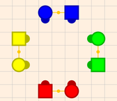 | 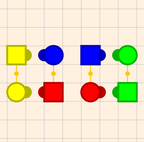 |

Notice that from a corner box if the  heads were to ‘face in’ and step back you would reform the squared set.   Thus a h-sq4 just ‘squishes’ the square without actually changing the order of anything.    Thus the square is not really messed up at all.   

Our goal initially is to see if we can make choreography that LOOKS like it is messing up the square but is not REALLY messing up the square.    That way we as a caller are ‘IN CONTROL’ but the dancers don’t recognise that they are really following a very simple pattern.   The simplest way of ‘slightly messing up a square’ is to have heads promenade half.    Here is what this looks like and what happens after we do a h-sq4 after the h-prom-½ 

| After H PROM ½                        | After H PROM ½; SQ4                        |
|:---:|:---:|
| 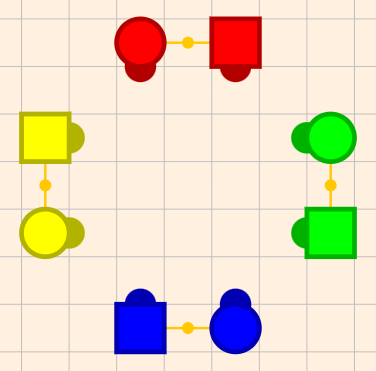 | 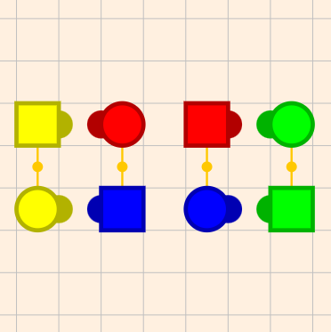 |

In square dance each man  has his partner, corner (to his left) opposite (across) and right and lady (to his right past his partner).  When we have the heads promenade ½ it sets it up so that everyone is near their ‘right hand’ person.   Notice that a h-sq4 again just ‘squishes’ the square.   So this square is ‘messed up’ but not by much (you are only a promenade ½ from being in order).  

This formation is called being ‘**across the street**’  because if the sides were the street, the heads crossed to the other side of that street.    Notice all we needed to do to get there is ONE CALL (promenade ½), so it is EASY to get across the street.   Notice that if the caller called an ‘allemande left’ from ‘across the street’, everyone would get their partner back but someone (head or sides), would have to promenade through the middle (effectively doing a promenade ½) to get home properly.    You have undoubtedly been in squares where this has happened, as it is BY FAR the most common way resolution fails.   

Now you might guess (and you would be right) that because there is no IMPORTANT difference between the heads and the sides, we would like to not worry about formation differences between asking the heads to do something and asking the sides to do the same thing.   If we were to ask the sides to promenade 1⁄2 and then square through 4, the formation would look different (the lines would be oriented on different walls, and different people would be on the ends or centers), but what DOES NOT change is that everyone is NEAR their ‘right hand person’ rather than their corner.   So we define ‘across the street’ as being ‘next to’ your right hand person.   This definition works whether the heads or sides did the action.    

What makes being ‘across the street’ a powerful concept is that there are MANY ways of getting there (and they all are equivalent).   By far the most common is the following sequence

```
rlt; pt; tb;    (right and left thru; pass thru; trade by).
```

Thus   

```
h prom ½       - gets you across the street
sq4            - squishes the square
rlt; pt; tb    - crosses the street again.
```

When you cross the street twice, you are back where you started, so you are in a ‘squished’ square and everyone is near their corner, so you can call allemande left.  

Congratulations!  You have made your first very nice patter sequence (this one took 29 beats).  You will notice that this is actually the start of a number of common singing call figures (they just need a small ‘zero’ at the end to use up some time before swing and promenade).  This is EXACTLY what happens in Boogie Shoes.   

## What is a Chicken Plucker (CKP) sequence?

Sequences that take you from a corner box to ‘across the street’ for historical reasons are called ‘chicken pluckers’.   The story I have heard (and I DON’T vouch for its authenticity), is that hay balers were called ‘chicken pluckers’ because they had arms that compressed the hay that looked like they were grabbing feathers and flinging them out (the hay balers were probably shedding fragments of hay that suggested this).     One of the most common ‘across the street’ sequences in the early days of square dancing was ‘**right and left thru; dive thru; centers pass thru**’.   This sequence makes the dancers bob up and down (because of the dive thru), and some caller thought the dancers reminded him of a hay baler in operation so he called the sequence a chicken plucker, and the name stuck.  

Note that there is some ambiguity among callers whether a chicken plucker is a sequence that **just** takes you across the street, or whether it is a sequence that takes you across the street **and back again**.    Thus some callers might say it is a ½ of a chicken plucker that takes you across the street.     

In this document I will uniformly use the term ‘Chicken Plucker’ (abbreviated CKP) to be a sequence that takes a SQ4 formation (a corner box) to **just** across the street (**not** there and back).    Thus in this document,  **rlt; pt; tb;** is a CKP.   (it is probably the most common chicken plucker).  

## The Joy of SQ2

When I first learned to call I NEVER used **square thru 2**.   However then I realized something 

**Sq2 equivalent to a Sq4 and a CKP (chicken plucker)**

That is if you want to QUICKLY get ‘across the street’ it is HARD TO BEAT sq2.   For example

```
h sq2;          - get across the street
rlt; pt; tb;    - get back;
al;             - allemande left (to finish it off)
```

Or  

```
h prom ½;       - get across the street;
h sq2;          - get back
rlt pt; tb;     - go across again
rlt; pt; tb;    - go back (again)
al              - allemande left (to finish it off)
```

Now the sequence above is repetitive but if you know more than one CKP (chicken plucker) you can make it more interesting.   Another very useful CKP sequence (worth memorizing) is **SQ3; TB;** (square thru 3; trade by)

Thus you can fix the previous sequence to be 

```
h prom ½;      - get across the street;
h sq2;         - get back
rlt pt; tb;    - go across again
sq3; tb;       - go back (again)    (33 beats  to get here)
al             - allemande left (to finish it off)
```

Which is a perfectly fine singing call figure for beginner dancers (who appreciate slower 33 beat figures) 

## Finding Zeros and CKP (chicken plucker) sequences

Notice we have ALREADY learned a bunch of ways of getting ‘across the street’.   They include  

- h prom ½  
- sq2 (as well as **srt; c pt** (star thru centers pass thru which is equivalent to sq2)   
- rlt; pt; tb;  
- sq3; tb;

Once you know these there is a general strategy to make a patter sequence

1. Use promenade ½, sq4 and sq2 to get to a box (either to corner or across the street)
2. Do something that does nothing (this is called a zero), this CAN be NO CALLS at all
3. Use a CKP sequence (we already know a few) to go across the street
4. Repeat steps 2 and 3 as needed until you are back to your corner
5. Allemande left, right and left grand, promenade

To do this well we need some Zero sequences, and it would not hurt to have some more CKP sequences as well.     

Well if you know some singing call figures (and you should have memorized 6 of them already, you can ‘mine’ them for zeros and CKP sequences.   For example take the following example 

```
h sq2; st; br; circ; cdtl; fl saq;
```

Which happens to be the SQ2-CDTL-FL figure in  [Square Dance Figures](https://docs.google.com/spreadsheets/d/1gVKHymIl4wy7DxqTW0ZrK7qhrNoGjJMnaHkxOlATpME/edit?usp=sharing).   Notice it begins with SQ2 (so the rest of the sequence starts across the street), and it ends in a corner box (because the spreadsheet’s ‘End’ column is c-box) which means you are facing your corner.     Thus the sequence without the sq2:

```
st; br; circ; cdtl; fl saq;
```

Is a sequence that starts ‘across the street’ and ends facing your corner.   But a sequence that does this is a Chicken Plucker (CKP).   Thus we have found a NEW CKP sequence ‘hiding’ in our singing call.   And we have ALREADY memorized this sequence because it is a good singing call     SCORE   

And it gets better.   If you stack two CKP sequences together, they go across the street and come back, which is a ZERO.    Thus we could turn the sequence above into a ZERO by putting another CKP sequence either in front of it or behind it.   For example

```
rlt; pt; tb;      st; br; circ; cdtl; fl saq;
```

Is a zero because it is simply two CKP sequences back to back.   

So we can find CKP sequences in figures that begin with SQ2.   If figures begin with SQ4 (or with prom ½; sq2, which we know does the same thing (across the street and back)), we can find ZEROS.   .  For example another sequence from [Square Dance Figures](https://docs.google.com/spreadsheets/d/1gVKHymIl4wy7DxqTW0ZrK7qhrNoGjJMnaHkxOlATpME/edit?usp=sharing) is PROM-RFL

```
h prom 1/2; h sq2; rlt; vl; btl; rfl; sl;
```

We see that h prom ½ takes you across the street and sq2 brings you back (just like SQ4).  The rest of the sequence ends in a c-box so it must be a ZERO (it starts in a corner box and it ends in a corner box).  

The main point here is 

- **Many singing call figures have zeros and chicken plucker sequences inside them**

And thus any singing call figures you already know, can also be  used to make zeros and CKP sequences to make interesting patter.   

Even the singing call sequences that end in waves or lines facing out  can be used, you just have to modify the endings so that they end in a c-box instead.   For example many figures that end with lines-out ended with a SQ3 to get there.   If instead of SQ3 you do a RLT; SRT; it changes it so that you are facing your corner rather than facing out with your corner.   Thus those sequences can be used as well.   We have already talked about if a figure ends in gbgb-wave you can add **br; rlt; sl;** to get to a c-box, so you can convert these sequences to zeros or CKPs as well.  

So in short those 4 singing call figures you memorized will come in quite handy in your patter.   

## Leveraging the ‘ocean wave-facing couples’ rule

Most of us know the ‘ocean wave-facing couples’ rule that states that things that can be done from waves can be done from facing couples (without calling step to a wave) or vice versa.  The intuition behind this that ‘step to a wave’ requires almost no movement so it is not surprising that the two positions are considered equivalent.   We can use this to get even more CKPs and zeros (starting or ending with waves instead of boxes (facing couples).   For example the sequence **h-sq2** leads to the **left** formation below if we then **step to a wave** we get the formation on the **right**.  

| After a H SQ2                        | After H SQ2; Step to a Wave                        |
|:---:|:---:|
| 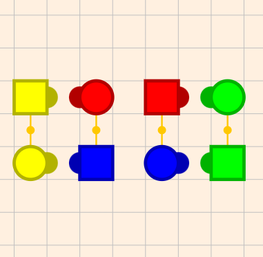 | 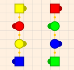 |

So the equivalence of waves and facing couples strongly suggests that the formation on the right is just ocean wave equivalent of being ‘across the street’ (that is being close to your right hand lady).  

Interestingly we can get to that same ending wave by doing a ‘**h-pto**’ (heads pass the ocean) followed by **extend**.  

| After H-PTO                        | After H-PTO; Extend                        |
|:---:|:---:|
| 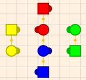 |  |

Notice these are the SAME ending formation.    Thus **h-pto; ex**; is the same as **sq2**.  The only difference is that h-pto; ex; ends in a wave, and sq2 in facing couples (which are equivalent).  

We can use this insight to come up with more CKP and SQ4 equivalents

- h pto; ex;  is the wave version of SQ2  
- h prom ½; h pto; ex; is the wave version of SQ4

Thus we can use these to start off our patter sequences to get even more variety.  
Finally it should be noted that the VERY COMMON sequence  

**rlt; vl;** (right and left thru; veer left)     is equivalent to  
**st; br;** (swing thru; boys run)

It is just that the first only works from facing couples, and the later will work there as well as waves.   Another useful piece of information is that **st; br;** takes about 3 beats LONGER than **rlt; vl;**, so this can help you speed up or slow down a singing call figure to make it work optimally for your dancers.   

You now have MANY building blocks in which to ‘play’ with patter modules.   You know how to get ‘across the street’ MANY different ways, including with ocean waves.    You can use PIECES of singing call figures to make zeros and other CKP sequences, and string these together to make interesting patter sequences.    Frankly this is enough to do very nice patter (and you never needed to resolve an arbitrary square).    

## Foolproof resolution - two couple resolution

Using modules and CKP sequences is a GREAT way to call patter, however because you are constantly going ‘across the street’ it is VERY EASY to forget which side of the street you are on (do not underestimate the likelihood of this happening, it happens to EVERYONE).  If you can REMEMBER your head couple and that man’s corner, you can always know what side of the street the formation is in by simply looking if the head man is ‘next’ to his corner (in which case is he is not across the street) or not (in which case he is).   Thus you HAVE to DEVELOP the DISCIPLINE of reminding yourself every few calls where your focus couple and his corner is.   If you can do this reliably, you are home free.   

But if you are calling modules you also have to remember your ZERO and CKP sequence correctly.   Thus there is definitely room for error when you call patter using modules.  Once you have made a mistake there is no way of correcting it (unless you know how to resolve)  

Sometimes you want something that is more ‘foolproof’.  The good news is such a technique exists.  The idea is to simplify things so that you only have to remember JUST ONE COUPLE.   Because dancers often dress alike you often don’t even have to remember anything (the clothing does it for you).   You also only need this one couple ON THE WHOLE FLOOR.   Typically this is easy to find (you either know a couple who is dancing together or you can use clothing to match the couple).   

The basic idea behind this way of calling is to divide the square in two and never let the two sides of the square interact with each other.   Thus you are effectively calling not a 4 couple square but a 2 couple ‘half square’, and there are not that many ways that just two couples can be mixed up.  The procedure is as follows

1. Locate the 1 couple you want to focus on, let's assume they are a **head couple**.
2. In that case, have the **sides** SQ4.   This will make two half-squares of 4 people (2 couples) that are facing each other and one of the half-squares has your focus couple in it together as a couple (facing in on the ends). Your square will look like this (the red couple is our focus couple).

    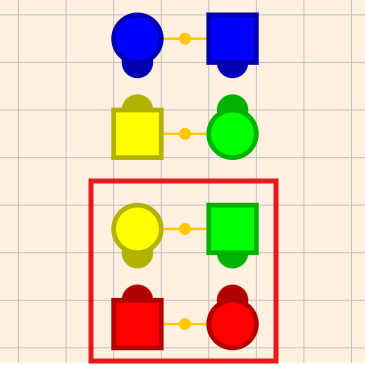

    Notice that at this point, everyone is facing their corner so the square is ‘resolved’ (you can call an allemande left).
3. Call ANYTHING you want as long as it does NOT cause the set of 4 people in the half-square (in the red box) to leave that half square.   In practice this means **no** circulates, trade-bys and most bend the lines (there are others illegal moves, but 80% of all calls are OK, just don’t let people ‘escape’ (or enter)  the group of 4 you formed) Notice that because you never let any of the dancers ‘escape’ this group of 4 people, it will ALWAYS contain your focus couple.    Let’s assume that after calling some calls the square has ended up in the following configuration:

    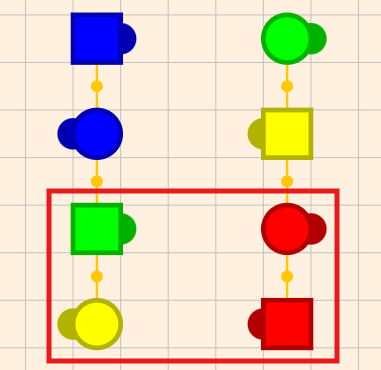

4. Our job is to get that focus couple back on the end facing in (just like it was after the SQ4).  If we do this the square IS RESOLVED (because this gets the lower box back EXACTLY like it was after the SQ4, which is resolved, and by the mirror property the other half of the square MUST be like it was after the SQ4 (that is, it is resolved too).   Thus ALL WE NEED TO DO TO RESOLVE IS GET our FOCUS couple on the end facing in.

Notice that this technique has a couple nice properties

1. You only have to remember one couple (you don’t have to remember a corner because  you always keep your corner ‘near’ your focus couple and thus if you can get your focus couple on the ends, you will be resolved.
2. You can call A LOT of choreography with just those 4 people.   Probably 80% of all mainstream calls can be called with just 4 people (not allowing them to ‘escape’)

So all we need is a technique for going from an arbitrary formation of 4 people, to boxes with the focus couple on the end.    We do this in two steps:

1. Get to lines facing in.
2. Rotate the box as needed to get the focus couple on the end.

Note that step 1 you probably will happen by accident if you just keep calling legal calls.  Pretty quickly one of the formations will be lines facing in.    However if you want more explicit instructions

1. First, avoid sashaying your dancers.   This means no girls-run, box–the-gnats’, u-turn-back, or half sashays.   Your beginner dancers will thank you.
2. If the girls and boys are not facing the same direction, a boy-run will is your go-to call to get the girls and boys facing the same direction.
3. If everyone is facing out, a partner trade will get them facing in.
4. If your group of 4 is in an ocean wave with the boys on each end, the REC; SAQ; (recycle, sweep a quarter) will bring them to lines facing in.   (ST; BR; BTL; will work as well).   If the boys are in the center of an ocean wave, a BR-BTL will get you to lines.

Once you are at lines facing in (and they are non-sashayed), there are actually very few possibilities.   Here are the important ones (the others are mirrors of these).    Please notice where our focus couple (the red one) is.    

| Couple-beside                                         |      | Couple-Facing (centers)                                              |       | Couple-Facing (ends)                                              |       |
|:---:|:---:|:---:|:---:|:---:|:---:|
| 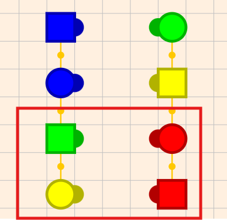 | FL → | 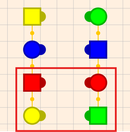 | RLT → | 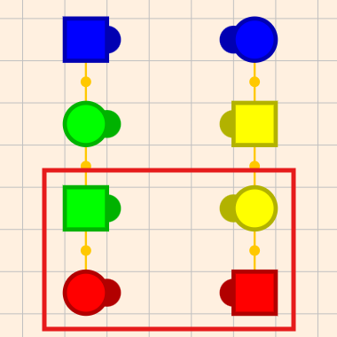 | SRT → |

Notice that the last possibility (focus couple-facing on the ends) is VERY close to being resolved.  All you need to do is a SRT (star thru), and you are resolved.    The middle possibility (focus couple-facing at center position) can be converted to the  last possibility (focus couple-facing on the ends) with a RLT (right and left thru).    So we have techniques for resolving the last two formations.  

Thus ALL WE NEED is a way of turning the first possibility (Couple together) into EITHER of the other two possibilities.     Turns out FL (flutterwheel) does that.    Typically you don’t want to call flutterwheel without some ‘flow’ so you will probably want to do a RLT; FL;   This extra RLT will not interfere with our algorithm.    RFL (reverse flutterwheel) will also work, but again you want some flow, so doing a PT; PTD; RFL; (pass thru; partner trade; reverse flutterwheel) does the conversion with nice flow.    Either of these work (and many more as we will see).  

Thus our algorithm is to get the square to lines facing in.  Then: 

1. If the focus couple is beside each other (couple-beside) do a RLT; FL;   This will lead to the focus couple to be facing each other (either ends or centers).
2. If the focus couple is facing in the centers, do a RLT to get the focus couple to the ends (still facing each other).
3. Do a SRT to resolve the square.   Follow with an allemande left, promenade.

So we now have a complete algorithm 

1. Pick a focus couple (we assume **heads**)  
2. If the focus couple is the heads, call ‘**sides** SQ4’   
3. Call ANYTHING that keeps the box of 4 people in one half the square **together**.  
4. Get those 4 people to lines facing in (br is often useful)   
5. If the focus couple is together (in the same line-of-4, facing the same direction), call RLT; FL;   to get them facing each other.    
6. If the focus couple is facing each other in the center, call RLT to get them facing each other on the ends.     
7. Call SRT;  
8. Square is resolved, call AL (Allemande Left) PROM HOME.

### Couple-beside-to-couple-facing calls

There are other calls besides FL (Flutterwheel) that can get the focus couple from being beside each other to facing each other (step 5).    However the MOST COMMON CALLS (e.g. SRT; RLT; SQ3; SQ2; PT; VL; CDTL; PTO; ST; BR; FW; TQ; SB; DT; PTC; PTD; CIRC; TB;) will NOT do this.   **Only a handful of calls have this couple-beside-to-couple-facing property**.   Here are the most common calls that have this property.   You can see the list is not huge.  

1. LC   (Ladies Chain)  
2. BTL (Bend the Line)  
3. WHD (from lines facing out)  
4. FL;  (Flutterwheel)  
5. RFL;  (Reverse Flutterwheel)  
6. SAQ (Sweep a Quarter)  
7. C TD (Centers Trade (of a wave or two-faced line)  
8. REC (Recycle)  
9. WAD (Walk and Dodge)  
10. SCIRC (Split Circulate)

Note also  these calls move from couple-facing-to-couple-beside AND BACK, so a figure with TWO of these will  cancel out (thus ZEROs tend to have an EVEN number of these calls in them (check out the figures in [Square Dance Figures](https://docs.google.com/spreadsheets/d/1gVKHymIl4wy7DxqTW0ZrK7qhrNoGjJMnaHkxOlATpME/edit?usp=sharing) and see).   In particular if you flutterwheel (or reverse flutterwheel) and call sweep a quarter, the two ‘cancel out’ and you will NOT change the couple-facing-to-couple-beside property.   Thus instead of **right and left thru; flutterwheel**, you could use recycle (e.g. **pass the ocean; recycle; star thru)** or wheel and deal (e.g. **pass thru; wheel and deal; centers pass thru; star thru**), to get from couple beside to couples facing in the resolution technique.  

## Use Taminations Sequencer to Practice Resolution

The taminations sequencer is a GREAT way of practicing resolution.   Please see the [Taminations section](05-the-taminations-sequencer-is-indispensable.md) in this document on setting it up well.   You can start right away with the foolproof technique and simply practice it (try it now)    When you can resolve easily using the default setting you are ready for the next step.  

**Tip: Use the Sequencer’s ‘color random’ feature to make resolution more realistic.**  
In the taminations settings there is a ‘Dancer Color’ setting, and one of the options is ‘random’  If you choose this, then each dancer will be given a different color.   This mimics real life (where people no longer dress alike so you can tell which person goes with which couple).   This makes resolution SIGNIFICANTLY harder.   Thus when resolving when couples are color coded is too easy, this is the next step to take.   Note that you can simply type  ‘color random’ as if it were a call to set this, and ‘color on’ to put it back to its default coloring (you can also go to the settings pane).  

Note that the key to mastering random color is to practice the memory techniques mentioned in [Memory practice (who’s your corner?)](01-when-you-are-just-thinking-about-calling.md#memory-practice-whos-your-corner) section.   It is all about discipline (reminding yourself who your focus couple is at regular intervals, until it is easy).   

As you read this section on resolution I STRONGLY recommend that you experiment with the sequencer as you read.   As you read a resolution technique, you should do it yourself in the sequencer.   Then try variations.   When I tell you that certain calls will make the square change in various ways (e.g. [couple-facing-to-couple-beside](#couple-beside-to-couple-facing-calls)), TRY IT, and see that it works.   It is by doing things like that that you really learn.   

## Expanding on Foolproof Resolution

Note that one of the steps in foolproof resolution is to call ANYTHING that keeps the 4 people together.    This includes all ‘two couple’ calls (because no person will leave the group of 4 people after the call), but it ALSO includes sequences that cause people to LEAVE as long as they RETURN by the end of the sequence.    These sequences ALL have this property

1. You can call a FW; C PT;  (Ferris Wheel, centers pass thru)  
2. You can call a PT; WHD; C PT;  (Pass Thru; Wheel and Deal; Centers  Pass Thru).  This sequence also  has the effect of moving  from couple-beside to couple-facing.     
3. ANY ZERO, including ZEROs that are two CKP sequences back-to-back.

Because singing call figures can be mined for ZEROs and CKP sequences (as noted previously) You have already memorized some useful ZEROS and CKP sequences and you can use them here to make your ‘foolproof’ choreography more interesting.   

You can also use any of the SQ4 equivalents to ‘get into’ your group of 4 people (e.g SQ2; CKP).  Thus you really can make pretty interesting choreography using this ‘foolproof’ technique. 

### Expanding MORE on foolproof resolution

In the previous section we expanded our choreography out of our group of 4 by adding ANY ZERO we like.    However we can expand this even more with a simple technique.   Previously we disallowed all moves that moved people out of their group of 4   We relax this to allowing other moves, as long as we use them in sequences that bring the group of 4 together again.   For example.  

1. Trade By  **if you follow it by** a  CKP (e.g. sq3 Trade by) OR a Swing Thru, boys run couples circulate.
2. Couples Circulate **if you follow it by** another couples circulate OR a ferris wheel centers square thru 3  .
3. Circulate from Waves **if you follow it by** another circulate, OR swing thru boys run couples circulate.
4. Wheel and Deal (from lines facing out), **if you follow it by** a centers pass thru
5. Dive Thru **if you follow it by** a centers square thru 3
6. Ferris Wheel **if you follow it by** centers pass thru

This is more flexible than the idea of using zeros, because the sequence does not actually have to be a true zero, it just needs to bring the group of 4 people back together.   You can often do this with just one or two more calls (as shown above).   The list above is not exhaustive, and moreover as you can see you can have more than one way of following any particular call.   Typically chunks of singing call figures (that you have already memorized) will work.   Thus you can do this for ANY call you like,  just make sure that you have confirmed in TAMINATIONS that by the time you finish your sequence the same group of 4 people are together on one side of the square (the formation does not matter).  

If your focus couple is REALLY set in your memory (e.g. you know them as a couple, or they are dressed in a way that makes it very obvious they are a couple), then you can extend the technique even further.    The idea is that you get your focus MAN partnered with the lady who is NOT his partner  (which has to be his corner).   You then can call any calls that stay in odd station (see [The Joy of Stations](#the-joy-of-stations), but it is most calls except column circulate and spin chain thru) but you specifically WATCH this MAN and CORNER on EVERY CALL.   You can do this by simply keeping them coupled up, but you can also allow them to leave each other as long as you bring them back together at least every few calls.  By doing this repeatedly, you force yourself to remember these two people.   When the man and his corner are together as a couple, put them on the ends facing in as a couple in a box.   If at this point the MANs ORIGINAL PARTNER is not in the box of 4, then do a chicken plucker and she should be there.   At that point you have reestablished your group of 4, and can resolve using the foolproof resolution technique.

What is wonderful about this technique is that the HARDEST thing to do in resolution is REMEMBER a PARTNERSHIP and a CORNER.   But notice this breaks it into two easy pieces.  First find a partnership that is easy (by clothing or existing knowledge).   Then keep your chosen couple and that man’s corner together in a group of 4 for a bit.  When you are ready, break away with the MANs corner using a move like couples circulate that breaks the group of 4  At this point only worry about tracking the MAN and his CORNER.   You can keep them together as a couple for a while, then let them separate for a call or two before bringing them back together.   Keep doing that until it is easy to remember that they are corners.  Finally when you need to resolve, get this man-and-corner on the ends facing in as a couple in a box, if needed use a chicken plucker to get the man's partner in the group of 4, and then resolve as normal for foolproof resolution.   .    

## When Patter Breaks

Inevitably, you will forget who your focus couple or corner is, or maybe your pilot square breaks, but the result is that you can no longer resolve the square.     You can just tell people to go home, but in most cases that is not optimal.    The goal is to keep them dancing and to ‘simulate’ a successful patter.   You do this by

1. If the break occurred after just a few seconds, just call something until you have had them dancing for 30-60 seconds (a normal length between resolutions).
2. If you can find SOME couple on the WHOLE floor (e.g a couple dressed alike) bring them together.  For extra credit get them on the ends in boxes (couples facing each other (like the side couples are after the heads square thru 4).
3. Call an allemande left, and promenade.    Tell them to fix it on the promenade.

Typically if many squares crashed during a sequence you don’t want to end on that.  Thus pull one of your robust singing call sequences and do a quick patter with that so that you end on success.

### Getting Home with a little bit of help from your friends.

For beginner callers, when patter breaks it is best to keep it simple as mentioned above, and simply have them fix it on the promenade (after letting them dance a reasonable time), however, with just a LITTLE help/luck, you can resolve the floor from ‘nothing’.   

What you need to start is 1 couple that you can identify.   If you know the dancers, you probably know a couple that dances together, and that will do the trick. Otherwise look for people who have dressed alike.  Typically you can find at least one such couple on the whole floor.   

Next, make your best guess whether you are in even or odd station (explained later), and if you are in odd station get to even station (again explained later).   Then get your couple together as a couple in lines.     Then ASK THE DANCERS if they are with their partner.   Either everyone will say yes (if you are in even station), or only half the dancers will say yes.   If only half answer yes, then get to even station (e.g. TQ, CIRC, BR, SL), and get your couple back together and ask again.   Now everyone will say yes.    Next call TQ, CIRC, BR, SL, which will get you back to odd station where people are either facing their corner or their right hand lady.   So ask the dancers if this is their CORNER.  If they say yes, do an ALLEMANDE LEFT, if they say no, do a CKP (rlt, pt, tb), and ALLEMANDE LEFT.   Thus with typically 2 questions you can fix any floor.  You can add a bit of showmanship (like saying, OF COURSE it is, or ‘I was just checking if you knew’, or “who put the corner in the wrong place’ …), to turn it into something fun for the dancers.   They will actually be happy that they could help you get THEM home.     

## The Joy of Stations

It is not an understatement that reading the CallerLab document ‘**[Controlling Choreography With Relationships](http://knowledge.callerlab.org/wp-content/uploads/2015/11/Controlling-Choreography-With-Relationships.pdf)**’ by Barry Johnson, changed my life as a caller.    I do recommend reading it at some point in your calling career (including right now if you are eager).    If you would rather not, you can get what I think are the most important points by simply continuing to read.  

The most important point made in that paper is the concept of a **STATION**.  A Station is PROPERTY of the square as a whole.  There are 4 stations

- 0/4  Partner station    
- 1/4  Corner station  
- 2/4  Opposite station  
- 3/4  Right hand lady station

Notice these stations are named for the position of someone else in the square, and I have numbered them by how many ¼ promenades the ladies man need to move to become that person’s partner.     Moreover I will call partner and opposite stations **even stations** (since they are even numbers) and the right hand lady, and corner stations **odd stations**.  

Stations are a property of HALF A SQUARE (a group of 4 people).  Consider the following square after the call ‘sides SQ4’ has been called.    


*After SIDES SQ4*

Notice you can always divide the square in two different ways (either a horizontal or vertical line that cuts the square in two), and the concept of stations works either way, but one way of dividing the square is usually much more useful.  In the case above a horizontal line makes more sense because we have VERY FEW moves that keep a vertical line of dancers together but we have MANY calls that keep a box of 4 dancers together.   Thus for this case we choose the horizontal line (and we keep that choice fixed for the duration of our analysis).   If we had started with a heads SQ4, we would have chosen a vertical line.   

Once we have chosen our line that divides the square in two, we have two groups of 4 dancers.  Because of the mirror property we can pretty much only deal with ONE of these two groups, because the OTHER group MUST BE THE MIRROR IMAGE of this group.    So we focus our attention on just this one group of 4 dancers.  

In the example above we say that the square is in **corner station**, because in this group of 4 **everyone is with their corner** in that group of 4 dancers.   Note that stations are pretty robust, because MOST calls do NOT break up the group of 4 (indeed you need 4 dancers to perform the move), and thus you **stay in corner station**.   

Also note that stations require that ALL people on that group of 4 have the relationship.  Notice that the head boy (red)  is with his partner in that box of 4, but we do NOT call this partner station because side dancers (green and yellow) are NOT with their partner in this box of 4   Everyone has to have the SAME relationship, and it is actually somewhat surprising (but true) that in EVERY square you have to be in ONE of the stations (there is no ‘none of the above’ or ‘mixed’ station).   

Now if we do a [CKP sequence](#what-is-a-chicken-plucker-ckp-sequence) (e.g. RLT; PT; TB) we get the following formation

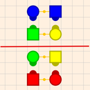

*After RLT; PT; TB;*

We call this formation **right-hand-lady station** because now everyone in our group of 4 is with their ‘right hand dancer’ (note that this is true for the girls as well as the boys, we would more correctly call this right-hand-dancer station).    Again EVERY dancer is with their right-hand person.   

If on the other hand we had started with a square set and called S LR (**sides lead right**) we would get the following formation.  

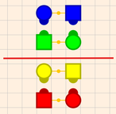

*After Sides Lead Right*

Notice everyone is with their partner, and so we call this **partner station**.  Finally if we do a FL; CKP (flutterwheel; right and left thru; pass thru; trade by) from this formation we get the following formation:

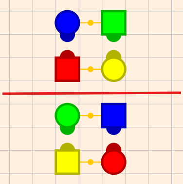

*After FL; RLT; PT TB;*

In this case everyone is with their opposite.   This is hard to see because NO one is with their partner.   However if you remember that red’s opposite is blue, and green’s opposite is yellow you can confirm that everyone is with their opposite, so this is **opposite station**.  
These examples also illustrate a couple important properties

1. In **odd** stations (corner or right-hand-lady), **EXACTLY one couple is together** (an odd number) in the group of 4
2. In **even** stations (partner or opposite) either **two couples or no couples are together** (an even number) In the group of 4

These properties are true in general.   Now we see why sometimes when we are in lines everyone is coupled up (even station) or just two of the 4 couples are (odd station).   

There is another property that is good to notice

- It is pretty **easy to move among odd stations** (a CKP will do it), **or among even stations** (a flutterwheel (or any of the other flutterwheel-like moves change the [couple-facing-couple-beside](#couple-beside-to-couple-facing-calls) property) and a CKP will do it.

It turns out the another really important property is the reverse 

- It is **hard to move from an even station to an odd station** or back.

The reason is that in order to move from an even station to an odd station (or back), you  need ONLY 2 dancers to CROSS THE CENTERLINE of the square.   Most calls do NOT do this (either they are 2 couple calls (no one crosses the center) or 4 people cross (most circulates).  The exceptions at mainstream are

1. Circulating from a column
2. Asking just half the dancers to circulate (e.g. girls circulate, or ends circulate)
3. Spin chain thru
4. In a double-pass thru formation, asking JUST THE CENTERS to do a [couples-facing-to-couple-beside](#couple-beside-to-couple-facing-calls) move.  (e.g. centers flutterwheel).

These are ALL RARE.   If you were ‘just calling’ you probably would not think to call any of these moves.    Thus once you are in even station you will probably stay in even station unless you purposefully do one of the things above.

Beginner callers that don’t understand what we have just discussed can often get ‘stuck’ trying to resolve because they get in opposite station (where no couples seem to be near each other), and they can’t seem to get their focus couple together.    The standard advice for callers who can’t seem to get their couple together is to call  ACEY-DUECY (ends circulate centers trade) which will change you from even station (where you might be in opposite station), to odd station (where there will be a couple together in each group of 4 GUARANTEED)

**Tip:**  **When starting out, avoid even stations**.     When you do a SQ4 or a SQ2 you end in **odd station**, and so if you don’t call one of the 4 things above, you will stay in **odd station**.   Note that LR (lead right) from a static square will put you in **even** station, so to follow this tip, either don’t call lead right OR IMMEDIATELY follow it by one of the 4 things above (e.g.   lead-right; swing-thru; girls-circ; boys-trade, or lead-right; star-thru; touch-a-quarter; column-circ; boys-run)

Staying in odd station has other benefits:

1. In any group of 4 people there is ALWAYS exactly one couple.
2. You only have to remember your focus couple and that couple’s corner.  (that is, three people).   Knowing that you are in odd station allows you to just ‘know’ that the corner’s partner is in the correct place, without having to remember who he (she) is.
3. If you bring your focus couple to the ends (like we learned in the foolproof resolution) then you MUST be either next to your corner (in which case you are resolved)  OR you are next to your right-hand-lady (not your corner), in which case a CKP will resolve the square.

So all of this suggests the next step in your ability to resolve.   Once you have the foolproof resolution technique mastered (which by the way is just saying ‘stay in corner station’).   You can move on to the next technique which is ‘stay in odd station’.    It works like this.

1. Find your focus couple, and REMEMBER that couple’s corner.
2. Start your figures so you end up in odd station (e.g. SQ4, or LR followed by something that flips you to odd station).
3. Don’t call anything that will change station parity (that is, stay in odd station).  This is VERY easy to do (avoid columns and asking half the square to do something).
4. When you are ready to resolve, move your focus couple to the end of the line facing in (just like you did in the foolproof resolution technique).
5. At this point EITHER your focus couple is next to your REMEMBERED corner, or NOT (in which case it HAS to be the right hand lady (but you did not remember the right hand lady,, you just know it was not the corner).
6. If the focus couple is NOT next to the corner, then do a CKP.  That WILL bring the corner next to your focus couple and the square is resolved.

It turns out, that step 4 (Bringing your focus couple to the end of line), is a bit harder than it was in ‘foolproof resolution’   That is because in foolproof resolution, the focus couple could not ‘escape’ its group of 4, and thus the couple was already ‘near’ each other.    So it is helpful to know techniques to bring two people together as a couple.     Here is a technique to do it (there are many others).  

1. Get to 2 faced lines.    (SRT; RLT; VL or ST; BR;  are typical ways of getting there)
2. Next, we want our focus couple to be in the SAME LINE.  If they are not in the same line we will use a couple’s circulate to fix that, BUT we need to set it up properly.  Consider this formation where we are trying to bring the red couple together.

    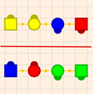

    Notice if we circulated from here both red people move to a new  line (you can also have the situation where both red people stay in their current line).  Thus in this formation circulate will NOT get us what we want (our focus couple in the same line).   Fixing this is easy.   Simply call girls (or centers) trade.   This give us 

    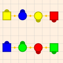

    *After Girls Trade*

    And so after a couple’s circulate we now have our red couple in the same line.   

    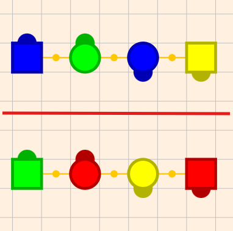

    *After Couple’s Circ*

    Once we have our focus couple in the same two-faced line we are actually back to our ‘foolproof resolution’ case.   We just need to bring our focus couple to the end of boxes.   To get the focus couple-facing each other, we start with a ‘chain down the line’ and then add a flutterwheel as needed (that is if our focus couple is in the line together facing the same direction, in the formation above, the CDTL does this so we need to add a FL to get our focus couple facing each other). This gives us this

    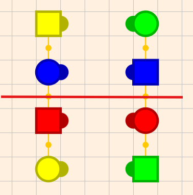

    *After CDTL; FL;*

    And following the foolproof resolution technique, we need to do a RLT (to get the focus people on the end) and then a SRT to get them facing in.   The result is

    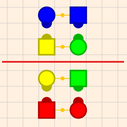

    *After RLT; SRT;*

    We remembered our corner (yellow girl) and since she is next to our focus man (red boy), we know we are resolved.  If she was not there, we know that we would need to do a CKP (e.g. RLT; PT; TB;) to finish the resolution.

Now get out taminations, and try this yourself after messing up a square.   

## A Word about the Focus Couple’s Corner

Just now I said that we remembered our focus couple (red) and that couple’s corner, and I said that that was the **yellow girl**.    This is very natural for men because their corner is always a girl.  However for women callers, it is likely to be more natural to say that **green man** is the corner that you remember (after all the red girl is part of the focus couple and the green man is that girl’s corner)     **You can use either the focus boy’s corner OR the focus girl’s corner** in all the techniques described here.   You just have to be consistent.   Women callers are likely to want to do that (do whatever feels easier for you).  

## Resolution from Arbitrary Formations

So far, we have made resolution easier by limiting what we call (either staying in corner station, or staying in odd stations).   These limits had the advantage that we did not have to remember as much (just a couple, or just a couple and a corner).    To do full resolution you have to remember one more thing, but you have a choice.

1. You can remember if you are in even or odd station.
2. You can remember your corner’s partner (thus 4 people).

Of the two, the first choice is easier, because you only have to remember one bit (yes or no) question (Not a choice among 4 boys), and YOU as the caller have CONTROL over what station you are in.    Thus I personally follow (and would recommend) technique 1 along with the following tip

**Tip:  Any time you change to even station, cross your fingers (or change the hand you hold your mic with)**.   Uncross them when you are back in odd station.   This way you are not REMEMBERING anything, your FINGERS are.  

Notice you can call ANYTHING you like and you can always resolve knowing only a focus couple and a corner (and if you are in odd station).    The way is straightforward.  If you are in even station, get out of it (e.g. do a column circulate or and acey deucey).  Then resolve as in the ‘stay in odd station’ technique.   

If you want to try option 2, the technique is simple enough.   Get your focus couple together and get to lines.   Either BOTH of your remembered couples (you are remembering 4 people now), are coupled up or only one of them is.   If both of them are coupled up, you are in partner station (which is even), so switch to odd, and then resolve as normal (So the only reason you remembered that 4th person is to figure out if you are in even or odd station).   

## Direct Resolution from Even Station

So far, I had suggested that if you are in even station and want to resolve, you flip to odd station and then resolve.   There are also a number of ways of resolving from even station directly.   I would only use these once I COMPLETELY mastered resolving from odd station.   

To resolve when you know you are in even station

1. Get  your focus couple together (works just like in odd station) and get to lines facing in.
2. At this point ALL the couples in the line are with their partner (you are in partner station).
3. Look at your focus man and his corner.   They are either ‘next’ to each other (if you joined hands and circle left they would be next to each other) or they are  not.
4. If they are next to each other call  SRT; SQ3
5. If they are far away from each other call SRT; PT

That is it!    This is so simple that you have to wonder why I suggest resolving from odd station.  Why not stay in even station, and resolution is so easy?   There are a few reasons.  

1. Even station include opposite station, in which NO ONE is coupled up.   This is SO disorienting for beginner callers, that it is ‘dangerous’ (I can’t get my focus couple together).   Odd station always has a couple near each other, which is very helpful.
2. MANY singing call figures are exclusively in odd station.   Thus odd station is very ‘familiar’ to both dancers and callers.
3. When you resolve from even station directly, you end in a trade-by configuration when you allemande left.   Beginner dancers find that disorienting.   Odd (corner) station has more options (boxes, waves, lines facing out).

Thus usually callers master odd station and then move on to mastering even station.  When you are comfortable with even station, there are some very nice ways of getting you home that dancers like (like ferris wheel, centers sweep a quarter and back out).   Typically ‘novel’ ways of getting you home (e.g. last call is leaders cloverleaf, trailers partner trade)  involve partner station.   

## Resolving When the Dancers have had only 1 or 2 Lessons

Early in lessons it may be difficult to resolve a square because you have not taught all the calls you need to resolve.   Typically you teach the following calls in the very first lesson

**RLT (Right and Left Through); PT (Pass Thru); LC (Ladies Chain);  Prom 1/2**

During that first lesson resolving is not an issue (you never mess a square up).   In the next lesson I teach the following calls 

1. [Star Thru](https://www.tamtwirlers.org/taminations/#?level=Basic%201&animnum=0&link=b1/star_thru&main=ANIMLIST&detail=CALLS) (starts from facing couples).
2. [Bend the Line](https://www.tamtwirlers.org/taminations/#?level=Basic%201&animnum=0&link=b1/bend_the_line&main=ANIMLIST&detail=CALLS) (starts from lines (facing in, facing out, two faced)
3. [Couples Circulate](https://www.tamtwirlers.org/taminations/#?level=Basic%201&animnum=37&link=b1/circulate&main=ANIMATIONS&detail=CALLS) (start from two-faced lines)
4. [Veer Left](https://www.tamtwirlers.org/taminations/#?level=Basic%201&animnum=0&link=b1/veer&main=ANIMLIST&detail=CALLS) (starts from facing couples, makes a two faced line)
5. [Lead Right](https://www.tamtwirlers.org/taminations/#?level=Basic%201&animnum=6&link=b1/lead_right&main=ANIMATIONS&detail=CALLS) (starts from home position, gets to facing couples)

These calls along with the ones from the first lesson (in particular ladies chain) are enough to resolve ANY square.   In particular   

- LC is like a RFL  
- RLT; PT;  is like a SQ3  
- RLT; VL; CIRC; BTL; RLT; LC; SRT;  is a CKP.  
- H SRT; C PT; is like a SQ2.    
- H PROM ½; H SRT; C PT; is like a SQ4  
- H LC; H PROM ½; H LR is like a SQ4

This is enough to do the resolution techniques described previously.   You don’t have any way of moving from even to odd station (unless you teach girls circulate from 2-faced lines) but you can use the direct resolution from even station technique so you never need to go from even to odd station.  

And of course you can always use ONLY the singing call figures in [Early Dances](https://docs.google.com/spreadsheets/d/1gVKHymIl4wy7DxqTW0ZrK7qhrNoGjJMnaHkxOlATpME/edit#gid=1969018810) and thus never get the squares messed up in the first place.   This might be the best answer.  After a couple more lessons, you can resolve the way you normally would, so this problem goes away quickly enough.   .