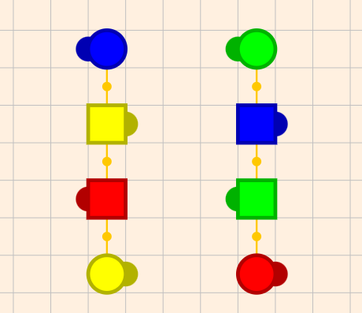
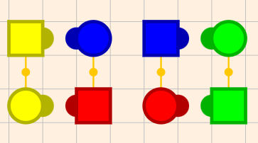
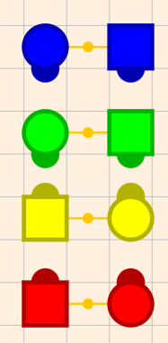
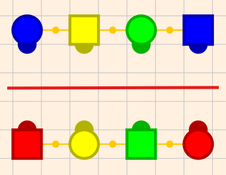
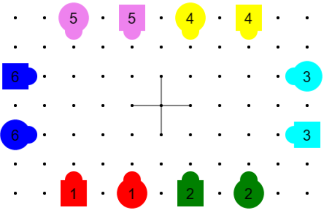
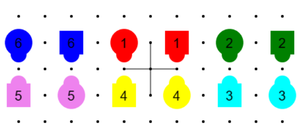

# Advanced Things

Up until now I have been covering things that I believe every caller should
know.   From here on, I will be discussing things that you may never use as a
caller, but I thought they were pretty cool, so I am sharing them with you.   

## Making Resolution more Diverse

Up until now, all patter sequences end in an allemande left, a right and left
grand and a promenade.   While this pattern is very reassuring to beginner
dancers, in general a caller is looking to eliminate ‘ruts’ where certain
sequences are called over and over.   

### Make promenades unambiguous

* Good calling is UNAMBIGUOUS.   When you call ‘promenade’ when the couples are
  near home, you have made it ambiguous:  Should they stop immediately or should
  they go all the way around?   Ambiguity is BAD, so never let this happen.   If
  you are near home when you call an allemande left, either  
  * Simply call ‘square your sets with a clap clap clap’  
  * call a right and left grand (which takes you half way around), so that the
    promenade is half way (and unambiguous). 

    If you are halfway around when you call an allemande left either

  * Just call promenade home  OR  
  * Just call right and left grand but tell them to square their sets.

  Notice in all cases, things are unambiguous.  

### Eliminating the Allemande Left

* If you are at a corner box and ready to call ‘allemande left’, you can call
  the following sequence 

  **Right and left Thru; Half Sashay; Pass thru;** (to a  right and left grand)

  Instead of the allemande left.   Note that this sequence can confuse beginner
  dancers so walk it slowly the first time if there are beginners on the floor.   

* Now that single circle is a mainstream move, the following move can work when
  you are at a corner box 

  **Single circle; Pass thru;** (to a  right and left grand)

### Allemande Left from a Left Handed Wave

A pretty cool way of getting out of a left handed wave (e.g. after a dixie style
to an ocean wave) is to call an ‘allemande left’ (since centers and ends are
already holding left hands).   However for this to work you need to be in a
‘left handed corner wave’, that is your square needs to look like this  

| Left handed corner wave | corner box |
|:---:|:---:|
|  |  |

Notice that the left handed corner wave (on the left) looks like a corner box
AFTER everyone stepped to a left handed wave (so ends and centers are holding
left hands).   You can get to this position from a corner box by the following
sequence

**Slide thru; right and left thru; dixie style; boys trade**

Thus you can simply add this to any corner box resolution to make your allemande
left a bit more interesting (dancers will be surprised by it, but they tend to
do the right thing so they are successful, and thus like it).  

### Resolution by having the centers sweep a quarter.

There are some very nice resolutions that after a wheel and deal or a ferris
wheel, you have the couple in the center sweep a quarter and back out to their
home.   This is a very nice resolution which dancers do like.  

The resolutions up until now always had the potential of ‘promenade home’ at the
end of them.  This was nice because it meant you did not need to get your focus
couple to their home, you just needed them near their corner.   The resolutions
described in this section are harder because

1. You must resolve directly from a partner station (which is not as common)  
2.  You must land couples exactly at home (no promenade to save you).    

In the explanations below it is assumed that your focus couple is the \#1 head
(red) couple.   Hopefully it is obvious that it will work for a side focus
couple by swapping all the references to heads and sides.   

1. Get to partner station with all couples partnered up in lines facing in. Your
   \#1 couple needs to be in the upper right quadrant facing in like this.  


*#1 (red) couple in upper right quadrant*

Note that at this point it does not matter which couple is facing your \#1
couple.   The goal of getting here is so that a **wheel and deal**, will land
your \#1 couple at home.  

2. **IF your head couple is FACING the \#4 couple** (that is the \#1 man is
   facing his corner), then you can do a **pass thru; wheel and deal centers
   sweep a quarter;** and you are resolved (say square your sets with a clap
   clap clap to let the dancers know this).    
3. If not, call **pass thru; wheel and deal**.   Your square will look like
   this.



*After pt; whd;*

4. Call **centers pass thru**;  Notice your \#1 man is NOT facing his corner at
   this point   
5. Call the following  
    **Right and left thru; veer left; ferris wheel; centers sweep a quarter;**  
    This is relatively easy to remember because it is the standard ferris wheel
    zero (rlt; vl; fw; c pt), where the last part (centers pass thru) is
    replaced with sweep a quarter  
6. The square is resolved.  

Note that if you notice that after the sweep a quarter your sides are swapped,
you can of course simply do a **sides right and left thru**, but you can also do
a ‘**sides square thru two; allemande left**’ which does not look as much like
you are correcting a mistake.  

#### Getting your \#1 couple to the upper right quadrant.

The first step of the above technique is to get your \#1 couple to the upper
right quadrant of the square.   It is tempting to do this with **bend the line**
calls, but this often results in bad flow (the flow from a bend the line when
the lines are facing in is almost always bad).     Instead it is better to move
your \#1 couple to the correct side using **Chicken Pluckers** or
**Circulates**, and then once there use a **right and left thru** to get the \#1
couple facing the correct quadrant.   To do this you will want to use
[couple-beside-to-couple-facing](06-learning-to-resolve-a-square.md#couple-beside-to-couple-facing-calls)
calls to get your couple from lines facing in to couples facing side walls then
use circulates or pt; tb; to move the couples around.   Chain down the line;
flutterwheel, is also a very nice way of getting a couple turned by 90 degrees.  

Finally note to get your \#1 couple facing the right way, the lines facing in
have to go left or right (the LINES go to the SIDEs, even if the PEOPLE are
facing the head walls).   Note that 2 faced lines and WAVES, which have their
LONG dimension on HEAD walls, are associated with LINES facing in or out, or
with BOXES that have their long dimension on SIDE walls.   Thus when I talk
about wanting a square oriented side to side (long dimension toward side wall or
LINES facing in facing head walls), it will often involve WAVES and 2-Faced
lines which have their long dimension toward head walls.      Thus I do not
think of the call  ‘pass the ocean’ changing the ‘orientation’ of the square.
There are relatively few calls that do, and they include

1. Wheel and Deal (very common)  
2. Bend the line from lines facing in.    
3. First Couple go Left Second Right  
4. Cloverleaf  
5. Tag the Line (sometimes)  
6. Circle to a Line   
7. Centers Split 2 around 1 to a Line  
8. Separate around 1 to a Line

#### Placing your secondary couple home first

The instructions above assume you ‘place’ your \#1 (focus) couple first, and
then arrange your secondary couple (the focus man’s corner and his partner) to
sweep a quarter home.   Sometimes it is more convenient to place the secondary
couple first (because the square is already oriented that way, or the couple is
closer to its home).   You can do this, but the instructions change slightly.
Obviously if you are trying to get your \#4 couple placed home, you  need that
couple to start out in the lower right quadrant facing the side walls.  However
now the ‘Wheel and deal case’ happens when the secondary man is NOT facing his
corner.    I don’t generally recommend learning to do this until you have
MASTERED the technique using the \#1 couple and have it down REALLY well.
Otherwise you will easily confuse yourself.   

## Progressive Squares

Progressive squares is the name for the technique where you have adjacent
squares exchange dancers.    What makes it cool, is that dancers are dancing
with a LARGE number of new people and if the caller can get everyone back with
their original people (either back where they started, or at some other point on
the floor), it is VERY impressive.  Check out

[Progressive Squares YouTube
Video](https://www.youtube.com/watch?v=xp8hYLmilnw&t=286s)

Now I understood the basics of how this worked.   I knew that if you exchange
dancers with another square, perform a zero, and then exchange them back this
would obviously work.   But it definitely is fragile.   If at any point you mess
up your zero, you are in deep trouble and this made me leery of calling
progressive squares.    However I had an epiphany, when I realized I could SIGHT
CALL progressive squares WITHOUT having to remember more than the standard
information (a couple, the man’s corner, and whether you are even or odd
station).    This makes progressive squares ROBUST (I can use zero modules, but
if I mess them up, I can still get everyone back).   This technique is what I
want to share with you now.   

### First the Ground Rules

There are a few different ways of exchanging people across squares, but one of
the more common is to have lines facing out and these lines end up facing
couples from the adjacent square.   When you are in this position you define the
new call, **move on,** to mean anyone facing people in another square will pass
through, and those who are not facing another square (the edges), will do a
partner trade.    This is basically a ‘trade by’ but for the whole floor instead
of a single square.   Dancers are used to this and typically get it right.   

Progressive squares need the squares to be set up on a GRID.  Thus some
organization might be needed before you actually start the tip to get the
squares aligned.   It is nice if the number of squares is a RECTANGLE (e.g.  6
squares on a 3 x 2 grid)  but it is STILL possible to do progressive squares
with JAGGED  grid of squares (e.g. 5 squares in arranged as a row of 3 and a row
of 2), but you have some limitations that I will mention later.   

Progressive squares with ‘**move on**’ **don’t really work well with singing
calls**.   There are two reasons for this

1. When you exchange couples with another square, you end up with a square that
   has two heads and two sides, however both heads want position 1 and both
   sides want position 2\.    Thus you can never ask them to promenade home
   because people will conflict about where  home is.      
2. The ladies are progressing to their corner on the 4 figures in a singing
   call, which interacts badly with progressing lines between squares.  

The way they fix this in the YouTube video above is that they have the line
leave the square and COME BACK WITHIN each figure.   Thus as far as the singing
call is concerned, no progression happened.  This obviously works, but dancers
barely interact with dancers in the other square before it is time to go back to
their original square and complete the swing and promenade.      

So here we are just going to talk about  PATTER.   There is an interesting
progressive square technique that works for singing calls (with ladies
progression), but it does not feature **move on**. 

### The Technique

The key to my epiphany was, you guessed it, **stations**.    Consider the
configuration of the square after calling SQ4 and SRT from a home square.   



*After SQ4; SRT*

For stations, we get to divide the square in two however we like and we often
choose boxes, but because it is LINES that move across the squares it is useful
to divide the square into two lines.    
Notice that we ARE in corner station (in each half of the square everyone is
with their corner).  In particular the bottom half has our focus couple (the red
couple), as well as that man’s corner (the yellow girl).   Notice that these are
the people WE NORMALLY TRACK to resolve a square (we also remember if we are in
even or odd station, we know currently we are in odd station (because we are in
corner station).   I am going to call this kind of line a CORNER LINE (it is a
line and we are in CORNER station).   

When we do a pass thru, move on, notice that this CORNER LINE moves TOGETHER to
the new square.    If we STAY in odd station, then all we need to do is make
sure that a line with these SAME people moves back together.   If what we did
was a zero, this would be true, but ALL we need is for the same people to go
back together.  For example consider the following formation  


Notice that this is also corner station and if we did a **pass thru; move on**;
the same 4 people would go back to the square they came from.   Once these
people are back in their original square, you can resolve the square as you
would normally do.  

The **KEY POINT**, is that **YOU ONLY TRACK THREE PEOPLE ON THE ENTIRE FLOOR**
(just like for a single square).    To keep things simple let us assume you have
a RECTANGLE of squares (all rows of squares are the same length)  So the basic
strategy is as follows

1. Get to a ‘corner line’ where all three of the people you  track are in a line
   facing in.  
2. Move them to another square with a **pass thru; move on**;    
3. ONLY allow **this** group of 4 people to move between squares.   (you can do
   this by making sure that you are in ODD station, and your group of 3 are in
   the line).  You can move to the square above or below, left or right, just
   make sure they go TOGETHER.  **Do NOT let your Focus group bounce off the
   edges of the rectangle of squares** (that is when you call ‘move on’ your
   focus group is ALWAYS moving to a new square).    
4. When you want to resolve, just **retrace your steps** of 3 people back to
   their original square.  
5. Then resolve as normal.  

So the only additional piece of information you need is the ORIGINAL square of
your FOCUS couple (and corner).      This technique is VERY similar to what is
advocated in the ‘station’ paper ‘[**Controlling Choreography With
Relationships**](http://knowledge.callerlab.org/wp-content/uploads/2015/11/Controlling-Choreography-With-Relationships.pdf)’.
There they recommend that you get into a station (say corner station), and STAY
there for the rest of the patter.   In their scheme you can move around, but
always with your station person (e.g. corner for corner station).  In
progressive squares we are keeping the WHOLE group of 4 together and moving
around the squares in a similar way.    

Note that the reason for the ‘no bounce’ rule in step 3, and the ‘retrace your
steps’ rule in step 4 is to keep bookkeeping to a minimum.   The issue is that
dancers that do the partner trade (I call it bouncing off a wall) **change
direction**, while those who do the ‘pass thru’ part **do not**.   This means
that the ‘other half’ of the square associated with your line is **NOT** always
exactly the opposite of your focus line (in fact it usually ‘chases’ the other
line).   Because of this, getting your focus line back to the original square
(say in a small loop around the floor), will NOT guarantee that the other half
of the square will make it back too.    The easiest way to ensure that both
halves of the square make it back is to RETRACE YOUR STEPS.    This ALWAYS works
because for each half, the ‘way back’ always exactly balances the ‘way out’,
regardless of the path.     We will relax this requirement later, but for now we
keep things simple.  

Thus I recommend a very simple path to start: say over 1 up one then reverse and
bring them back.  

### Implementing the Technique

To implement the technique given above, you need to be able to get back to
corner lines (or partner lines if you use those), at will, with the lines FACING
the direction you want.  This is not something you had to do before to resolve,
so it is something that needs to be broken down into simpler pieces.  We assume
you are in the correct station you need for transition (odd if you use corner
lines, even if you are using partner lines).  We get ready for transition in
three steps.  

1. Get the lines (facing in) oriented the way you want it  
2. Get your focus GIRLS in the same line using a SRT; CKP; SRT;(star thru,
   chicken plucker; star thru) if needed   
3. Get your focus BOY in the same line as the GIRLS using any
   [couple-facing-couple-beside](06-learning-to-resolve-a-square.md#couple-beside-to-couple-facing-calls)
   move (e.g RLT; FL).  

To implement step 1 you need moves that change the orientation of FACING LINES.
Surprisingly **Bend-the-line from two-faced lines** does **NOT** do this, but
here are some things that DO 

1. **Bend the line from lines** (either facing in or out, but out typically has
   better flow) (e.g. PT; **BTL**)  
2. **Wheel and Deal**, (e.g PT; **WHD**; C SQ3; SRT)  
3. **First Couple Left Next Right**.  (e.g. SRT; PTC; DPT; **FLNR**)  
4. **Centers Split 2 around 1 to a line**  This call sashays, be careful (e.g.
   SRT; **C S2L**; Box Gnat; RLT)  
5. **Cloverleaf** (eg. SRT; PTC; DPT; CL; C SQ3; SL)  
6. **Circle to a line** (eg. SRT; CTAL)  
7. Other more subtle ways using Tag the Line, or split circ, Swing thru with
   BBGG waves.     

If after step 1 the two **FOCUS GIRLS** are in the same line then you can move
on to step 3\.   If not, do a **SRT** (star thru);  **CKP** (Chicken Plucker)
and another **SRT** which will fix it.  

If after step 2 your **FOCUS BOY** is in the same line as the focus girls you
are done. Otherwise you can use any
[couple-facing-to-couple-beside](06-learning-to-resolve-a-square.md#couple-beside-to-couple-facing-calls)
move (like **RLT; FL** (Right and left Thru, Flutterwheel)) to get the boy in
the same line as the girls.    

Finally you can do a **pass thru** or a **Square Thru 3**, to get your focus
line pointed out the right direction and call **move on**.  

#### Modules for rotating a line

Generally speaking in traveling squares, you are doing one of two things 

1. Making you pilot line continue move toward the wall it is currently facing
   OR  
2. Rotating your pilot line so it points at the ‘other’ wall (e.g. SIDE wall if
   it was facing HEADS).  

While you can do (2) from first principles following the technique above, it is
useful to have memorized some modules that simply do this.   It turns out such
modules always consist of three components. 

1. A call that changes walls, as discussed previously  (e.g. WHD, CL, …)    
2. A ‘circulate’ call  that causes people from one half of the square to move to
   the other half (e.g. circulate, trade by, or a pass through from a double
   pass thru formation).    
3. A
   [Couple-beside-to-couple-facing](06-learning-to-resolve-a-square.md#couple-beside-to-couple-facing-calls)
   call (e.g RFL).   

Here are some examples of modules that do this. Note that any time there is a
trailing Reverse Flutterwheel (RFL) you can substitute a Pass the Ocean, Girls
Trade, Recycle, Sweep a Quarter (or a RLT; FL).  You can also substitute a SRT;
RFL with a Touch a Quarter, Walk and Dodge, Partner Trade (TQ; WAD; PTD).
Thus the first three examples below are really just variations on a theme.  You
could easily create variations for the others.  

```
PT; WHD; C PT; RLT; VL; BTL;                keeps partners
PT; WHD; C PT; SL; RFL;                     keeps partners
PT; WHD; C PT; SL; PTO; GT; REC; SAQ;        keeps partners
PT; WHD; C PT; TQ; WAD; PTD;                keeps partners

PT; BTL; PTO; CIRC; GT; REC; SAQ;            swap partners
PTO; ST; BR; FW; DPT; CL; C PT; SL; RFL;    swap partners
SL; C S2L; SRT; TB; SL; RFL;                swap partners
PTO; ST; BR; FW; DPT; FLNR; RLT; FL;        keeps partners
PTO; SPLIT CIRC; ST; BR; RFL;               keeps partners
```

If you want to simply keep going in the same direction, you will want to have a
short ZERO between the **move on** calls.   Here are some  good zeros.   

```
PTO; REC; SAQ;
PTO; ST; BR; CDTL;
PT; WHD; DPT; FLNR;
PTO; GT; REC; SRT;
SRT; PTC; C SQ3; SRT;
SRT; PT; TB; (ANY CKP SEQ) SRT
```

However it is also nice to do something that is NOT a zero but keeps your focus
line together.   This way it is not so obvious that you always transition the
same group of 4\.  Here are some modules that are NOT zeros but keep the focus
line together (swapping partners) 

```
PT; WHD; DPT; CL; C PT; SL;           swaps partners
PTO; CIRC; REC; VL; CIRC; CDTL;       swaps partners
PTO; CIRC; GT; ST; BR; CIRC; CDTL;    swaps partners
PTO; CIRC; REC; PT; TB; SL;            swaps partners
PT; BTL; RLT; FL; PT; BTL; RLT         swaps partners
```

So one way of doing progressive squares is to memorize these modules.   This is
definitely a good technique, but like patter calling in general, it is good to
know how to ‘resolve’ in case you call one of your modules incorrectly.   If you
remember your focus couple and their corner, and you stay in odd station, and
you understand the resolution technique given above (that is how to  get your
people in a line), then, even if you ‘mess up’ you can recover and complete your
tip.  

**Congratulations\!  You now know how to do progressive squares.**  

### Coolness with a Rectangular Set of Squares

Finally I should mention that there is a nice property that happens if you have
a perfect rectangle of squares.   Let’s assume we have 3 squares left to right
and 4 squares top to bottom.   If you have your focus line in the bottom right
corner go three squares to the left it turns out that the ‘other half’ of the
square first ‘bounced off the right wall’’, and then ‘chases’ the focus line
down the row.  On the 3rd move to the left , the focus couple ‘bounces off the
left wall’ and the other line ‘catches up’, reforming the original square (but
now in the lower left corner).   At this point you could ask the dancers to
promenade home (now in a different location).  

Similarly if you have your focus group move 4 squares up all the squares will
reform at the ‘mirror image’ position.     Thus you don’t have to ‘go out and
come back’ and reform where you started, you can ‘go out’ and end your tip after
everyone has moved to their mirror image position (which is probably even cooler
than getting back to the square’s original position on the floor).   

Note that you DON’T need to go ‘all in one direction’ and then ‘all in the
other’.   You can keep zig-zagging across the rectangle as long as your focus
couple ‘bounces off’ exactly once off the left-right wall and once off the
top-bottom wall.   

### Jagged Sets of Squares

If you don’t have a perfect rectangle of squares (e.g. 5 squares in a row of 3
and a row of 2), the technique in the section above will NOT work because
dancers in different rows/columns bounce off the walls at different times
leading to chaos.    However the ‘**retrace your steps**’ technique (described
first), will **ALWAYS WORK**, even in the jagged case.   This is not as
impressive as reforming the square somewhere else, but it is still pretty cool.  

#### Working with 3 squares

The most likely jagged setup that you will work with is 3 squares.   Now you
might think that with three squares in a jagged formation that you could do just
a ‘PASS THRU; MOVE ON; operation twice in the same direction and that would be a
no-op (all your original square is back together again).  The rationale is that
this sequence would work with JUST a row of two squares, and dancers in the
‘lone square’ never leave their square and thus should be fine.   I thought that
at one time, and I WAS WRONG.  The reason is that when you ‘bounce off a wall’
(which is what one line is doing whenever you do a PASS THRU; MOVE ON) , you
SWAP ORDER.  Thus after doing two PASS THRU; MOVE ON operations it is true that
all squares have their original people in them, but the row that has two squares
your focus line bounced off the wall exactly once, whereas the row that had only
one square the line bounced off of two walls.   This means some squares have
done the equivalent of a right and left thru, while other squares have not.
Thus if you try to resolve and promenade home some square on the floor will be
wrong.   

The straightforward way to fix this is to simply fix the lonely square.   After
doing Pass thru move on, twice and while your focus line is still in a line,
simply ask the square that never interacted with another square to do a right
and left thru.   That will put all the squares in the same place (you can
resolve).   Then I would suggest that you make your focus line go in the other
dimension so that every square gets to interact with other squares.   

You can of course do this with other odd numbers (like 5), but in the case of 5,
you will not be able to go in the other dimension because there is not a
singleton square in that direction.  Thus the odd square will never get to
participate (sad).    To get everyone participating you will need to go out and
retrace your steps (which is OK).  

## Singing Call Progressive Squares

Unfortunately the technique above where you ‘move on’ to an adjacent square does
not work in a straightforward way with a singing call.  There are two reasons
for this.

1. As we noted before, when you exchange a line of dancers with an adjacent
   square you MUST exchange a Number 1 man (that is the head man with his back
   to the caller) with a number 3 man (the head man facing the caller).
   Because of this you end up with a square where two men think they belong in
   the number 1 position, and the square will crash on a promenade.     
2. Unlike patter, in a singing call, the ladies are rotating around the square
   and that adds another layer of complexity to get everyone back together if
   you are progressing between squares on every figure.  

There are a number of ways to try to get around these issues, but I happen to
like the one I am about to explain.    It is inspired by a ‘scatter promenade’
which a group of friends can do at festivals.   The idea is that when a
PROMENADE happens, everyone leaves their square (as couples) and promenades to a
new position in another square, and you continue dancing.   Typically only a
small handful of squares do this and they go to nearby squares.   There is
certainly a lot of chaos in the transition (it often takes time for everyone to
find a new square) and you certainly don’t end up with your original partner,
but the chaos can be fun if everyone has a free-spirited outlook.  

The interesting question is: can we do something LIKE a scatter promenade, that
avoids the chaos and allows people to end up with their partner at the end of
the singing call?   Surprisingly, the answer is YES and this is the technique I
will describe here.   

First to use the technique, the squares need an ORDER, that is each square needs
to know what the ‘NEXT’ square is.    For most venues, this is easy, you just
think of the squares on the floor as forming a ‘ring’ and the next square is
always the square in the counter clockwise (promenade direction).    This works
well, for numbers of 8 squares or less, but for 9 squares (a 3 x 3 grid) there
is a problem with the very center square.    You can fix this either by avoiding
the center square (push it into the outer ring), or simply have multiple rings
(you can have a ring of size 1 in your 3x3 grid, it just means that the very
center square will not progress (it progresses to itself)).   The rings can nest
if you like, or they can be adjacent rows of a grid (if you have an even number
of rows).    All that matters is that every square is reasonably close to its
NEXT square (rings do this naturally), and that everyone knows which square is
their next square.    

You also need to teach a new move called ‘PROMENADE HEADS (or SIDES) PROGRESS’.
When you call this it means that as the promenade happens the heads (and only
the heads) promenade to the NEXT square on the opposite side (thus the \#1
couple becomes the \#3 couple and vice versa).   Another way of thinking about
this is that the heads promenade ½ way but to the NEXT square.    The reason for
only promenading to the opposite side is that it is SHORTER (since they also
have to get to the other square), and you will find it VERY NATURAL to SLOT IN
behind the SIDES who are promenading normally.   It is a happy fact that this
works so well.    You can see the scatter promenade inspiration in this move,
but because we only ask HALF the square to leave, the half that stays acts as a
‘scaffold’ to reconstruct the square.   We are also giving the couples that do
progress (scatter) a definite destination and this destination is CLOSE so it
will not take much longer than a normal promenade.   This eliminates the chaos.   

You will want to practice this a few times in patter so that people get the hang
of it.   You also must warn them

1. Progressing gives the boys a NEW HOME (across the square)  Thus they have to
   remember to come back to this home until the next time they are asked to
   progress.   Trying to go back to their original home is the most likely thing
   to make the squares crash, but luckily the fact that SIDE couples get in
   their way if they try to go to the wrong home will usually ensure that they
   can recover from it reasonably quickly.    
2. When you first practice it in patter, have them promenade their partner (that
   is do an  allemande left your corner and then promenade your partner home
   HEADS PROGRESS).    
3. During the actual singing call the LADIES WILL PROGRESS AS NORMAL (that is
   you SWING your corner and promenade this new corner home.   However when you
   call HEADS PROGRESS you are referring to the BOYS (since the side lady
   progressed to the head position).  In short, ladies promenade home with
   whoever they swung as is normal for a singing call.     

Once you have taught the dancers HEADS (SIDES) progress, the technique is pretty
simple you do a singing call as normal (opener, two figures, middle break, two
figures and a closer), but during the first two figures you ask the HEADS to
progress on the promenade and on the last two figures you ask the SIDES to
progress.   If you do this everyone ends up with everyone they started with  but
the whole square moved two positions on the dance floor around the ring.    They
will have also danced with dancers from 2 other squares besides their original
square.  

As always, if the square breaks down, ask the dancers to form a static square
with SOMEONE waiting for the next figure.    Note that you may end up with too
many dancers for one square (basically someone forgot to progress).    The
‘extra’ couple needs to get the square that is missing someone (which SHOULD be
nearby).    Stress to the dancers that you HAVE TO PROGRESS if the caller tells
you to.   

### Tips for Singing Call Progression

1. YOU MUST progress HEADS twice FIRST and then the SIDES twice.   DO NOT
   alternate them in a singing call because it interferes with the ladies
   progression and dancers will not end up with their partner in the end.    
2. At least initially use a singing call with a CIRCLE LEFT figure for the
   middle break and closer (that is no grand squares, or stars).   This is
   because CIRCLE LEFT figures are VERY ROBUST if you start them late, so if
   there is some chaos during the progression, you can wait for the slow dancers
   and recover.   Remember the whole floor succeeds or fails together.    
3. Use SHORTER figures (e.g. 33 beats, NOT the usual 36-38 beats) because this
   gives the dancers some extra time to do the progression (or recover from a
   mistake).   I would use the same figure each time, because they have enough
   to worry about.  

## Six Couple (Rectangular) Squares

There will inevitably come a time when the turnout for a dance is not great, and
you have 6 couples but not 8 people to dance.   In the worst case you have 15
people and thus 7 people have to sit out.   This is when it is useful to create
6 couple squares (rectangles).  



I used to think that calling for 6 couple squares would be ‘hard’ because you
would have to remember the home position of 3 couples, and would require
remembering more.   It turns out **it is NOT significantly harder to call for 6
couple squares** IF YOU FOLLOW SOME RULES that allow you to LEVERAGE your 4
couple square knowledge.   You can EVEN do singing calls THAT do full lady’s
progression if you want.    Because it is EASY, it is nice to have this in your
‘toolkit’ if you even have dances with 12-15 people.    It is ALSO useful as a
WORKSHOP novelty because you can teach dancers slightly strange moves (like bend
the line or wheel and deal from lines of 6), which are novel and fun.  

### What is Different in 6 Couple Squares

Obviously the main difference between 6 couple and 4 couple squares is that you
have more heads than there are sides.    However because 80% of all calls are 2
COUPLE moves (they only need 4 people to do the move), ‘most’ moves ‘just work’.
However when you have lines of 6 (instead of 4\) like this



*After h lr; vl; btl;*

AND you are doing moves that are not ‘two couple’, then you run into issues.
The most important moves that are problematic are:

* **Bend the Line** from lines of 6 (not two faced).  
* **Wheel and deal** from lines of 6 (that is lines facing out). 

There are a few others, but they are rarer (Split 2 around 1, Separate around 1
…) Note that both Bend the Line and Wheel and deal CAN be done from TWO FACED
LINES OF 4 (which you can form).   

You will also find that **double pass through formation** in rectangles is
**weird**.   Moves that you would expect to form a double pass through formation
like Dive Thru, Pass to the Center, or Ferris Wheel end in this formation   


Notice that the very centers (couples 6 and 3\) are pointed in a way that is
opposite of the way you were probably expecting.   You would NOT want to call a
double pass thru (dancers would be confused).   Note that while you can’t call
double pass through from this formation you CAN call **Centers Pass Thru** or
**Centers Square Thru 3** from this formation and it works (you may have to get
the dancers familiar with the concept that there are TWO groups of centers
(highlighted in red boxes above), but dancers take to it quickly.   I will call
this formation the ‘**centers active**’ formation because it sets up the centers
to do things without the ends (and calling it double pass thru would be at best
misleading).    

Because we can’t call double pass thru, getting to a completed double pass
through configuration is also problematic, which means moves that rely on that
formation like 

* **Cloverleaf**  
* **Centers In**  
* **First Couple Left next Couple Right**

Do not work without modification.   

So there are a bunch of calls that ‘don’t work’.   The other main point is that 

* **Heads can do things that the sides cannot.**   

In particular your first calls to get you ‘to the grid’ will be to the heads.
**Square Thru \***, and **Lead Right** both work, but **only for the heads**.
There are a few things the sides can do, but it is questionable whether they are
worth calling.   

### What is The Same in 6 Couple Squares

What is amazing, however, is that SO MUCH just works in 6 couple squares.    In
particular, as a general rule, if you have a ZERO MODULE for a 4 Couple square
and it is LEGAL in a 6 couple rectangle, it is very likely a ZERO MODULE in a 6
couple rectangle.   In particular **MOST singing call figures in [Square Dance
Figures](https://docs.google.com/spreadsheets/d/1gVKHymIl4wy7DxqTW0ZrK7qhrNoGjJMnaHkxOlATpME/edit?usp=sharing)
work** (unless they hit bad formations).     This is absolutely FABULOUS because
it means that you don’t have to LEARN new singing call figures to call 6 couple
squares.   

Note that, sadly, **Heads (Sides) Promenade ½** is a problematic call and it is
used commonly in singing call figures.   The good news is that you can
substitute **Heads Right and Left Thru**, for the heads promenade ½ and the
figure will probably work.  

To prove sequences work for 6 couple squares, I have made a ‘Taminations
Sequencer’ like program that works for 6 couple squares 

[Six Couple
Simulator](https://vancem.github.io/Samples/SquareDanceSim6Couple.html)

It works very much like the taminations sequencer (but it is not animated, it
just shows the final formation).   Try out the figures and modules you know and
see which ones work.   

The fact that so much of what was DESIGNED for 4 couple squares just works on 6
couple squares  is nothing short of amazing.   It means that you can IMMEDIATELY
try 6 couple squares in your patter simply by using the singing call figures you
already know.  

### Resolving in 6 Couple Squares

But wait, it gets better.   Not only do most of your singing call figures work,
your RESOLUTION techniques work\!    This blew my mind.   It turns out that the
restrictions on what you can call (because they lead to problematic formations)
have an important side effect: they **keep the boys and girls in circular
order**.   Consider the following formation after a bunch of calls were made.  


It looks pretty messed up at first, but if you look at JUST the boys, you will
notice that as you go around the formation they are in order.    Notice it is
also true for the girls.   Now sometimes the order is clockwise and sometimes it
is counter-clockwise, but it is ALWAYS the case that the number 3 boy is between
the number 2 and number 4 boy.    TRY IT ON THE SIMULATOR\!  You can’t break
this invariant (without using illegal/modified calls).    

This has a REALLY important property:  

**Normal 4 Couple Resolution Will work**

In particular to resolve 

1. **Get to odd station** (you remember this, just like in 4 couple)  
2. **Get to 2 faced lines** (you will have three of them for 6 couple)  
3. **Get your focus couple in the same line** (our focus couple is the red
   couple) by using either girls trade or couple circulate (or both).   For 6
   couple the worst case is the following   

    

    *Worst case to get red couple in same line*

    This is the worst case because the red couple is ‘far apart’ and ‘pointed
    apart’.  Notice however that two couples circulates will cause the red
    couple to meet in the middle line.   Note that in the technique that uses
    girls-trades and couples-circulates will work for 6 couple but it might be
    tedious.   The basic idea is that you get the girl to the END line (using
    couples Circulates) and keep her facing OUT (using girls-trade) so that when
    you couple circulate she stays in that line as the boy gets closer.    In
    the case above, three couple’s circulates will do it.   That is pretty
    tedious, so you probably just put some random zeros in there to hide what
    you are doing.    
4. **Get your focus couple to the end line** (not the  middle line)  We did not
   need to do this in 4 couple squares because every line was an end line.
   Since your focus couple is in the SAME 2-faced lines already,  either they
   are a couple, or you can make them a couple by doing a girls-trade.   The
   couples circulate will get them out of the middle line.      
5. **Get your focus couple to the ends as a couple facing in**.   This works as
   in 4 couple squares.    
6. Do CKP (Chicken Plucker) as needed to get your focus boy facing his corner
   (who you remembered).   This is where the magic of keeping people in order
   comes into play.   Because people are kept in order, the only people ‘nearby’
   our red \#1 boy are his corner (the blue \#6 girl) and his ‘right hand lady’
   (the \#2 girl, who happens to be a head).  Thus if you are not already
   resolved, a CKP will swap the corner and right hand lady and resolve the
   square.  

The key point is that **RESOLUTION basically works unchanged**.   I encourage
you to ‘mess up a square’ remembering only a focus couple and a corner for that
couple and resolve it.  It should just work.  

### Singing Calls in 6 Couple Squares

Two notable things are pretty obvious

* Right and left Grands, and weave the rings need 7 hands instead of the normal
  5 hands to get back to your original partner.    You need to tell the dancers
  that (OR see below for an alternative)  
* Promenades (or anything else that ‘goes around’ the full circle) take longer
  in a 6 couple square.    This means that grid figures in singing calls need to
  be shorter so that there is more time for the promenade.  

While the fact that promenades take longer seems obvious there is an exception
to this rule.  

* The standard opener (Circle left, Allemande Left, Dosado, Allemande Left,
  Weave the Ring, Promenade home),  DOES NOT TAKE LONGER (if you are careful and
  let the dancers circle left at least ½ way (in normal singing calls you circle
  one full cycle, so it is not hard to circle left at least ½ way)).

This surprised me when I learned this, but the reason for this is the same
reason why this sequence is ‘MAGIC’ and can take longer or shorter depending on
how long you call ‘circle left’   The reason is that the sequence is not really
a LOOP.   The dancers go left, do stuff, and then come back.   Notice that the
distance they go DOES NOT DEPEND ON THE NUMBER of dancers but rather HOW LONG
YOU CIRCLE LEFT.    Thus it is the same for 6 couple squares as it is for 4
couple Squares (this is very nice).     The key to making this work however, is
that the ‘circle left’ has to be long enough so that the ‘weave the ring’ does
not ‘overshoot’ home (which forces the dancers to promenade once around, which
will take very long).  Normal singing calls naturally ‘circle left’ long enough.   

#### Weave the Rings

As mentioned, to make a right and left grand, or a weave the ring a ‘no-op’
(that is you come back to the person you started with) in a 6 couple square, you
need to advance 7 hands instead of the regular 5 hands.   Definitely have the
dancers count the number of hands so they don’t forget.    There is an
alternative, however, which is to do some other call that moves the ladies TWICE
in the weave direction (that is ladies to the left men to the right as you face
in).   This is most often done by doing a ROLLAWAY TWICE).  You can also have
the ladies chain 2 people.   Once you do this, you can then tell them to only go
the standard 5 hands.  

#### Ladies Progression

So the good news is that we use the standard opener, it will not take any more
time (great).   However normal figures will have us ‘swing and promenade’ and
those promenades WILL TAKE LONGER.   So this means we should pick SHORT figures
to give dancers more time for the promenade.    Since [**Square Dance
Figures**](https://docs.google.com/spreadsheets/d/1gVKHymIl4wy7DxqTW0ZrK7qhrNoGjJMnaHkxOlATpME/edit?usp=sharing)
comes with a set of ‘short’ figures, and we memorized one or two in case dancers
fell behind, we will just use one of those.  Choose figures that are around 30
beats.   

But we still have a problem.   Ladies have to progress 6 times, but we only have
4 figures.   The easiest way to solve this is to have the MIDDLE BREAK and
CLOSER advance the ladies.   It turns out that this is pretty easy.    If you
simply add a SINGLE ‘**ladies center men sashay**’ to your **circle left**, in
that figure, then whoever was your corner before becomes your partner (that is
the ladies advanced).   This assumes that you are doing a 7 hand right and left
grand.   Note that if you do a single ROLLAWAY and a 5 handed right and left
grand (or weave), it will also advance the ladies one position, so either option
is possible.  

So the rules for 6 couple singing calls are

1. Use the standard ‘circle left’ figure with a 7 hand weave.   This is a no-op   
2. Use short (30 beat) figures   
3. Add a ladies center men sashay to the middle break and closer (note that the
   weave the ring is 7 hands).     This advances the ladies for these two
   figures.  

That is it\!    Alternatively you could

1. Use a circle figure with **TWO** ROLLAWAYS  with a 5 hand weave.  This is a
   no-op.     
2. Use short (30 beat) figures   
3. For the middle break and closer, use a circle figure with a **ONE** ROLLAWAY
   and a 5 handed weave the ring.   This advances the ladies for these two
   figures.

You can now do 6 couple singing calls\!  

#### Grand Square

For your first 6 couple singing calls, I would stick with the ‘circle left’
opener.    However it turns out it IS possible to do a grand square with 6
couples.   It comes with TWO caveats.  

1. YOU WILL HAVE TO WALK THROUGH A TEACH WITH THE DANCERS.   The key to doing a
   grand square is that VERY CENTER people (e.g.  \#1 girl and the \#2 boy) 

    

    are NOT doing what they would normally do on a grand square.   They are used
    to facing their PARTNER after taking the first three steps, but now they
    face EACH OTHER.    When I teach Grand Square I mention that you will ONLY
    face your PARTNER OR your OPPOSITE, and you will alternate.   For these very
    center people, they will face their OPPOSITE or EACH OTHER (not their
    partner).   If they do this everything works.

    Note that it does not hurt to tell the sides that half the time they have to
    take bigger steps so they get past both head people, but generally they
    figure this out without instructions.  

2. The grand square does take the **same** amount of time as with a 4 couple
   square, HOWEVER typically afterward you call an ‘Allemande Left; Weave;
   Promenade’ which WILL take longer (because of the promenade).    You should
   substitute a SHORT Circle Left, Allemande Left; Promenade instead.   (by
   SHORT what I mean is that you only circle left slightly over ½ way.   We skip
   the weave the ring because if you are not careful you will end the circle
   left too soon, and the weave the ring will ‘overshoot’ home.    By
   promenading you avoid that possibility).  

I would only do a grand square with 6 couples if the dancers were above average
AND I was feeling adventurous.   When in doubt, skip it.  

### Three Couple Moves

The reason that things ‘just work’ in 6 couple squares is that whenever you do a
move that requires more than 4 dancers, you do it along the axis that has only 4
dancers in it.   This is what keeps everyone in order.     It is possible,
however, to do such moves along the 6 dancer axis.   For example you can **bend
the line** when lines of 6 are facing, however now you have to break the lines
BETWEEN the center two dancers to form lines of six on a new axis.  You can also
modify **wheel and deal**, so that it forms a **triple pass thru** formation.
You can also add a new call ‘**stretch ferris wheel**’ which also forms a
**triple pass thru** formation.   Once you have a triple pass thru formation,
other moves like **cloverleaf**, **cast off ¾** and **first couple go left, next
couple go right** work.    If you are interested in these moves just try them
out on the [Six Couple
Simulator](https://vancem.github.io/Samples/SquareDanceSim6Couple.html) to see
how they work. 

However, I should note that there are definite disadvantages to trying to use
these moves. 

1. These moves will break the sequential order in the square, which means that 4
   couple resolution techniques will NOT work.   There are resolution techniques
   that DO work, but they require that you remember the ordering of 3 couples
   (not just 2), which is a NON-TRIVIAL thing to learn to remember, and the
   resolution technique is more complex.    
2. The other problem of course is that you have to teach the dancers these new
   moves.   If the goal was to do something new/exciting, this is a PLUS (so you
   can do it for a workshop), but if the goal is just to allow 6 dancers to
   dance, then it is not worth it.  

You can mitigate the resolution problem by doing something very similar to what
we did to make corner box patter calling more interesting.   Remember in that
technique we got to a corner box (that is H SQ4), and then STAYED THERE.    We
made this more interesting by allowing ourselves to leave (e.g. calling a CKP),
but immediately got back (by calling another CKP).  In this case we can call
these 6 dancer axis moves (which could break resolution), but immediately come
back to a safe formation (when all the dancers are in order around the
rectangle).  Here are some sequences that do this.

* **pt; btl; (Any 2 Couple Zero from lines)  pt; btl;**     
* **pt; whd; zoom; triple pass thru (tpt); first left next right (flnr);**   
* **stretch ferris wheel (sfw); zoom; zoom; tpt; flnr;** 

Note that these are not zeros, they are moves that keep the boys (and girls) in
order around the rectangle.   You will need to (4 couple) resolve the square
from there.   If you want to pursue this then experimenting with the [Six Couple
Simulator](https://vancem.github.io/Samples/SquareDanceSim6Couple.html) is
definitely called for.
